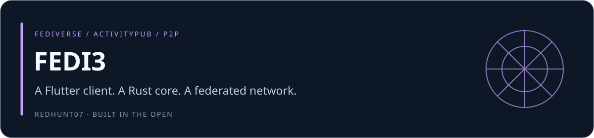
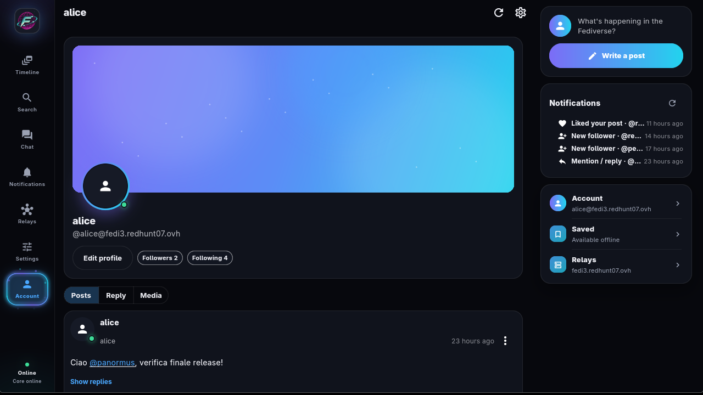
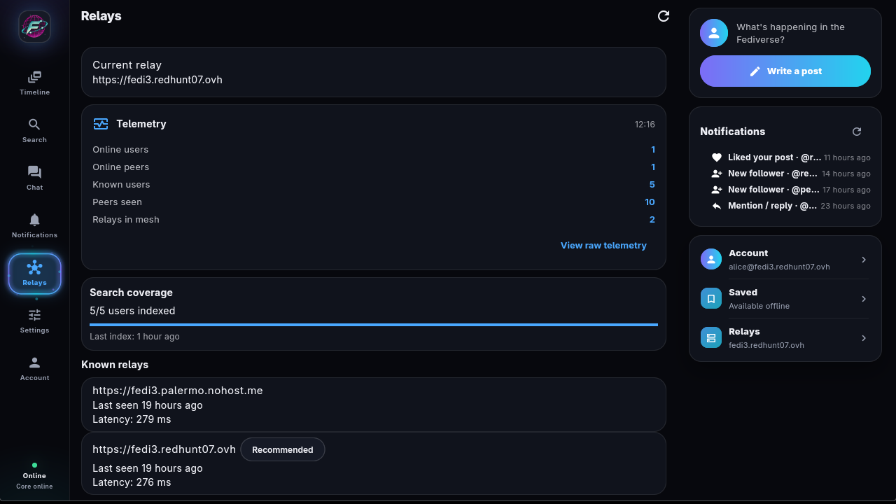
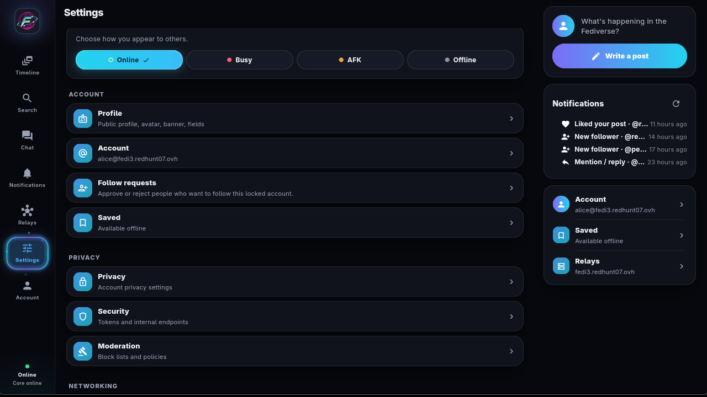
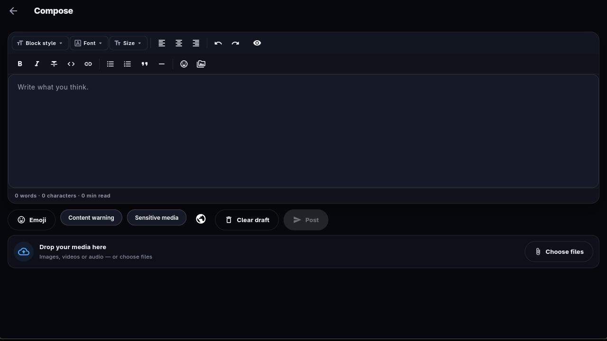
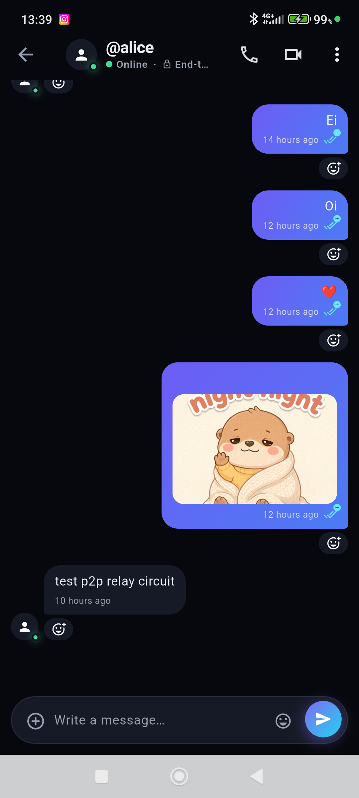
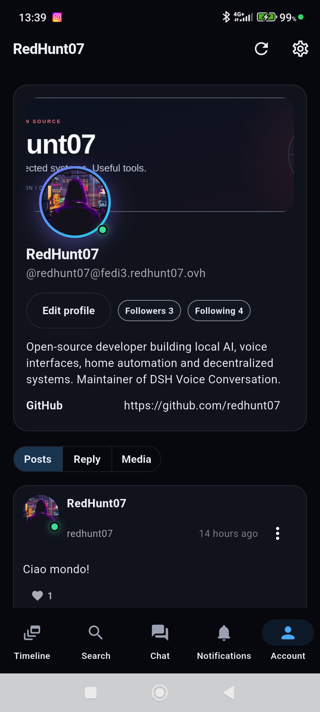
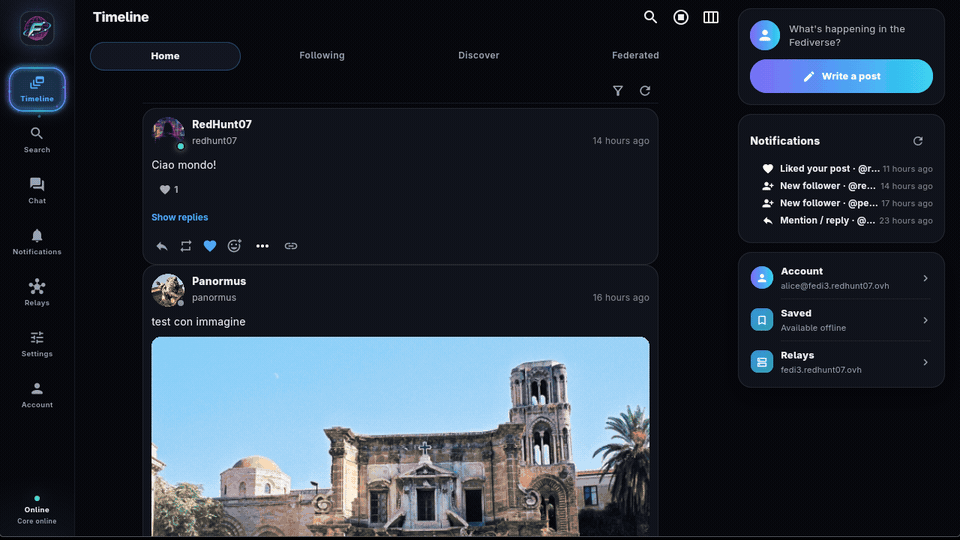
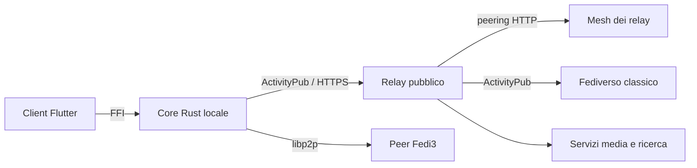

# FEDI3

[](https://github.com/redhunt07/Fedi3/actions/workflows/ci.yml) [](https://github.com/redhunt07/Fedi3/releases) [](LICENSE) [](Cargo.toml) [](app)

Autore: **[RedHunt07](https://github.com/redhunt07)** · [English](README.md) · **Italiano**



FEDI3 è un social federato con componente P2P: privacy-first, interoperabile con
il fediverso e resiliente senza rinunciare alla compatibilità con le istanze
ActivityPub classiche. È un client Flutter sostenuto da un core Rust locale, con
un relay pubblico opzionale per federazione e consegna offline.

> **Stato: pre-1.0 — release corrente [0.11.10](https://github.com/redhunt07/Fedi3/releases/tag/v0.11.10) (build 2013).**
> I pacchetti Linux x86_64, Android arm64-v8a/x86_64 e Windows x64 sono pubblicati
> nella pagina delle release con checksum SHA256. Gli APK Android sono build per
> installazione manuale firmate con la chiave di debug locale; iOS e macOS si
> compilano dai sorgenti ma non fanno parte dei pacchetti pubblicati. Vedi
> [verifica della release](docs/it/audit/release_0.11.10_2026-11-09.md).

## Screenshot

Client desktop (AppImage Linux, interfaccia in inglese):

| Timeline | Chat |
| :---: | :---: |
|  |  |
| **Profilo** | **Relay e telemetria** |
|  |  |
| **Impostazioni** | **Composer** |
|  |  |

Client Android:

| Timeline | Chat | Profilo |
| :---: | :---: | :---: |
|  |  |  |

Tour animato del client desktop:



## Indice

- [Cos'è](#cosè)
- [Funzionalità](#funzionalità)
- [Architettura](#architettura)
- [Requisiti](#requisiti)
- [Quick start: relay](#quick-start-relay)
- [Installazione del client](#installazione-del-client)
- [Sviluppo e test](#sviluppo-e-test)
- [Documentazione](#documentazione)
- [Sicurezza](#sicurezza)
- [Contribuire](#contribuire)
- [Licenza](#licenza)

## Cos'è

FEDI3 combina un core Rust locale, un client Flutter e un relay pubblico:

| Componente | Percorso | Responsabilità |
| :--- | :--- | :--- |
| Client Flutter | `app/` | UI, timeline, composer, chat, chiamate, media, impostazioni |
| Core Rust locale | `crates/fedi3_core` | ActivityPub, firme HTTP, chat end-to-end, cache, trasporto P2P, tunnel verso il relay; caricato dall'app via `dart:ffi` |
| Relay pubblico | `crates/fedi3_relay` | Compatibilità di federazione, routing, media, ricerca, spool per utenti offline, mesh dei relay |
| Protocollo condiviso | `crates/fedi3_protocol` | Tipi e modelli condivisi tra core e relay |
| Infrastruttura P2P | `crates/fedi3_p2p_infra` | Servizi mailbox e circuit-relay |
| Asset di deploy | `deploy/` | PostgreSQL, Meilisearch, Redis, coturn, nodo P2P, TLS |

Il relay non vede mai le chiavi private: firma e decifratura avvengono nel core
locale. L'ingresso federato richiede una firma HTTP valida legata all'actor
dichiarato e il core locale è protetto da un token interno, in ascolto su
loopback per impostazione predefinita.

## Funzionalità

**Client**

- Timeline home, following, discover e federata con filtri per media, risposte e
  boost; pagine profilo con banner, avatar, campi e post paginati.
- Composer con formattazione MFM, content warning, flag media sensibili e
  allegati multipli; visibilità pubblica, non elencata, follower e diretta.
- Chat 1:1 e di gruppo cifrata end-to-end con reazioni, sticker, file, conferme
  di lettura, presenza e creazione delle conversazioni in stile Telegram.
- Chiamate audio e video con fallback ICE/TURN, condivisione schermo con audio di
  sistema su desktop e cambio fotocamera anteriore/posteriore su Android e iOS.
- Notifiche per attività, chat e chiamate in arrivo, con suoni distinti e un
  servizio keep-alive che resta attivo quando l'app è chiusa su Android.
- Post salvati disponibili offline, ricerca globale, scoperta degli hashtag e
  visualizzatore media integrato.
- Impostazioni per aspetto e lingua, privacy, moderazione, networking, dispositivi
  audio, backup/esportazione e aggiornamenti verificati del client.

**Rete**

- Core locale con actor ActivityPub, outbox/inbox, firme HTTP e media storage; la
  modalità solo P2P funziona senza relay.
- Trasporto libp2p: identify, DHT, prenotazione relay, DCUtR, AutoNAT, mDNS,
  gossip e peer exchange, con persistenza dei peer conosciuti.
- Mesh dei relay su HTTP per scoperta e sync delle note tra relay, più una
  [directory dei relay](relays/relays.json) condivisa con ranking di latenza.
- Compatibilità del relay con le istanze classiche del fediverso, inclusi account
  migrati e normalizzazione dell'outbox.

**Sicurezza**

- Le chiavi private restano sul dispositivo; il relay non le vede mai.
- L'ingresso federato richiede una firma HTTP valida legata all'actor dichiarato.
- Il core locale è protetto da un token interno e ascolta su loopback per
  impostazione predefinita; i token del client vivono nel keyring del sistema.
- La chat è cifrata end-to-end con AES-256-GCM e chiavi derivate da Kyber768
  (senza forward secrecy: limite documentato).
- Le richieste federate in uscita applicano protezione SSRF, redirect limitati e
  limiti di dimensione del body.

## Architettura



Il client parla con il core locale via FFI; il core possiede identità, firma,
cifratura e storage e raggiunge la rete tramite il tunnel del relay o il P2P
diretto. Il relay è un front end di federazione con database e backend media; si
può installare da solo, con l'infrastruttura P2P o dietro YunoHost. Approfondisci
[decentralizzazione](docs/it/decentralization.md), [rete P2P](docs/it/p2p_network.md)
e [interoperabilità](docs/it/interop.md).

## Requisiti

- Rust stable (il workspace è compilato e testato con la toolchain stabile corrente).
- Flutter 3.38 o successivo per il client.
- Dipendenze desktop Linux per l'AppImage: `clang`, `cmake`, `ninja`,
  `pkg-config`, `libgtk-3-dev`, `libsecret-1-dev`, `libjsoncpp-dev`, `libmpv-dev`,
  `libasound2-dev`, `libpulse-dev`, `libwebkit2gtk-4.1-dev`. Vedi la
  [guida di build Linux](docs/it/build_linux.md).
- Docker e Docker Compose per lo stack del relay.

## Quick start: relay

Installazione automatica su Debian/Ubuntu e derivate Arch (relay + P2P, solo
relay o solo P2P):

```bash
sudo git clone https://github.com/redhunt07/Fedi3.git /opt/fedi3
cd /opt/fedi3
sudo bash scripts/install_server.sh
```

Vedi [installazione del server](docs/it/deploy_server.md) per la guida passo
passo, oppure [installazione su YunoHost](docs/it/deploy_yunohost.md) quando
nginx occupa già le porte 80/443. La configurazione manuale è qui sotto.

```bash
cp .env.example .env
# Modifica .env: almeno FEDI3_DOMAIN, FEDI3_RELAY_ADMIN_TOKEN (>= 32 caratteri)
# e FEDI3_RELAY_PG_PASSWORD. Il template avvia relay,p2p,caddy; aggiungi turn
# a COMPOSE_PROFILES (e imposta TURN_*) per le chiamate, search per Meilisearch.
# Dietro YunoHost usa COMPOSE_PROFILES=relay,p2p (senza caddy).
# Lascia vuoto FEDI3_RELAY_DB_URL: le credenziali PostgreSQL sono composte automaticamente.
docker compose up -d --build
scripts/relay_smoke_test.sh https://relay.example.com <ADMIN_TOKEN>
```

Configurazione completa, TLS e monitoraggio: [deploy del relay](docs/it/deploy_relay.md)
e [deploy su VPS](docs/it/deploy_vps.md).

## Installazione del client

Linux (Debian/Ubuntu):

```bash
curl -fsSL https://raw.githubusercontent.com/redhunt07/Fedi3/main/scripts/install_deb.sh | bash
```

Linux (Arch e derivate):

```bash
curl -fsSL https://raw.githubusercontent.com/redhunt07/Fedi3/main/scripts/install_arch.sh | bash
```

Entrambi gli installer accettano `--update-only` per aggiornare senza
reinstallare le dipendenze.

Windows (PowerShell):

```powershell
powershell -ExecutionPolicy Bypass -Command "iex (iwr -useb https://raw.githubusercontent.com/redhunt07/Fedi3/main/scripts/install_windows.ps1); Install-Fedi3"
```

Aggiungi `-UpdateOnly` a `Install-Fedi3` per un aggiornamento senza reinstallazione.
I privilegi di amministratore servono per installare le dipendenze tramite
winget/BuildTools; il core viene installato come attività pianificata `Fedi3 Core`.

Il client salva i token nel keyring del sistema: le build Linux richiedono
`libsecret` e un Secret Service attivo. Un AppImage si può compilare localmente
con `scripts/build_appimage.sh release`.

Android: scarica `app-arm64-v8a-release.apk` per un telefono ARM a 64 bit o
`app-x86_64-release.apk` per un emulatore x86_64 dalla pagina delle release,
verifica `checksums.txt`, poi consenti l'installazione da quella sorgente. Android
installa gli aggiornamenti solo quando i certificati di firma coincidono: conserva
la chiave di firma locale per le build future. I pacchetti iOS/macOS non sono
inclusi in questa release.

Disponibile dalla 0.10.0: Impostazioni → Aggiornamenti del client controlla le
release stabili e verifica i download SHA256. Gli AppImage Linux x86_64 possono
sostituirsi con un backup; Windows x64 usa uno ZIP verificato e un'installazione
guidata. I client precedenti richiedono un primo aggiornamento manuale. Vedi
[aggiornamenti del client](docs/it/updates.md).

## Sviluppo e test

```bash
# Rust
cargo fmt --all -- --check
cargo clippy --workspace --all-targets --locked -- -D warnings
cargo test --workspace --locked

# Flutter
cd app
flutter pub get
flutter analyze --fatal-infos
dart format --output=none --set-exit-if-changed lib test
flutter test

# Configurazione di piattaforma (manifest Android, entitlement macOS, Info.plist iOS)
bash scripts/verify_platform_config.sh
```

La suite non richiede Docker o servizi esterni: il relay è testato su SQLite e i
peer remoti sono server HTTP in-process. Il test opzionale delle quote PostgreSQL
gira in CI con un database effimero. Gli script di deploy e il contratto OpenAPI
sono validati da `scripts/tests/` in CI.

## Documentazione

Italiano:

- [Primi passi](docs/it/getting_started.md)
- [Installazione del server, Debian e Arch](docs/it/deploy_server.md)
- [Relay Fedi3 su YunoHost](docs/it/deploy_yunohost.md)
- [Deploy del relay](docs/it/deploy_relay.md)
- [Directory dei relay](docs/it/relay_directory.md)
- [Core locale e modalità P2P](docs/it/deploy_core.md)
- [Deploy su VPS](docs/it/deploy_vps.md)
- [Modello di decentralizzazione](docs/it/decentralization.md)
- [Rete P2P](docs/it/p2p_network.md)
- [Resilienza della rete](docs/it/network_resilience.md)
- [Push-forward receipts](docs/it/push_forward_receipts.md)
- [Interoperabilità](docs/it/interop.md)
- [Build Linux](docs/it/build_linux.md)
- [Guida dell'app](docs/it/app_guide.md)
- [Aggiornamenti del client](docs/it/updates.md)
- [Piano UX del client](docs/it/client_ux_plan.md)
- [Backup e ripristino](docs/it/ops_backup_restore.md)
- [Diagnostica](docs/it/troubleshooting.md)
- [FAQ](docs/it/faq.md)
- [Piano dei test](docs/it/test_plan.md)
- [API di sync del relay](docs/it/relay_sync_api.md)
- [Specifica OpenAPI](docs/openapi.yaml)
- [Annunci](ANNOUNCEMENTS.it.md) e [changelog](CHANGELOG.md)
- [Verifica della release 0.11.10](docs/it/audit/release_0.11.10_2026-11-09.md)

Documentazione inglese (default): [`docs/`](docs/README.md).

## Sicurezza

- Le chiavi private restano sul dispositivo; il relay non le vede mai.
- L'ingresso federato richiede una firma HTTP valida legata all'actor dichiarato.
- Il core locale è protetto da un token interno e ascolta su loopback.
- La chat è cifrata end-to-end senza forward secrecy (limite documentato).
- Le richieste federate in uscita applicano protezione SSRF, redirect limitati e
  limiti di dimensione del body.
- I token del client sono nel keyring del sistema; Linux richiede un Secret
  Service attivo.

Segnala le vulnerabilità in privato: vedi [SECURITY.md](SECURITY.md).

## Contribuire

Leggi [CONTRIBUTING.md](CONTRIBUTING.md) prima di aprire una pull request. I
contributi utili includono bug report riproducibili, test di protocollo/interop,
correzioni alla documentazione e modifiche mirate e revisionabili. La
documentazione è bilingue: inglese in `docs/`, italiano in `docs/it/`. Il progetto
segue il [Contributor Covenant](CODE_OF_CONDUCT.md).

## Licenza

AGPL-3.0-or-later. Vedi [LICENSE](LICENSE) e [NOTICE](NOTICE). Le modifiche alle
parti esposte in rete devono restare open source.
