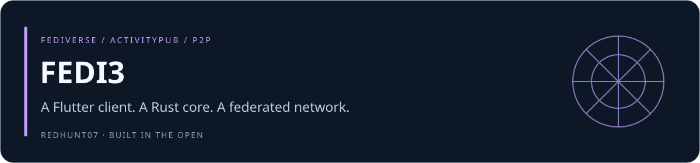
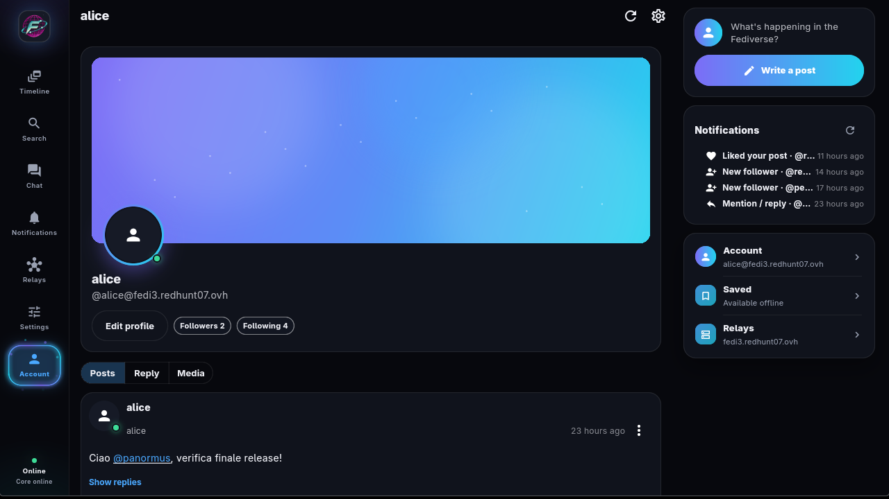
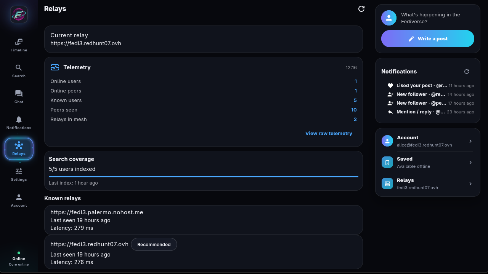
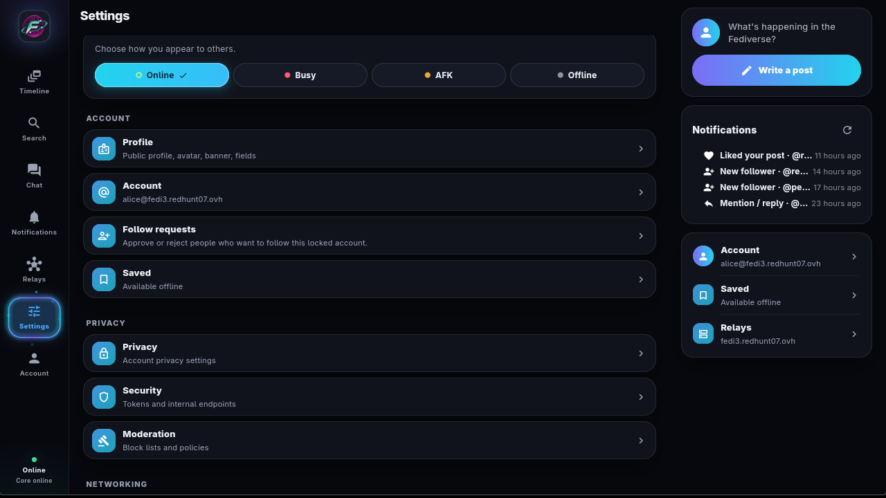
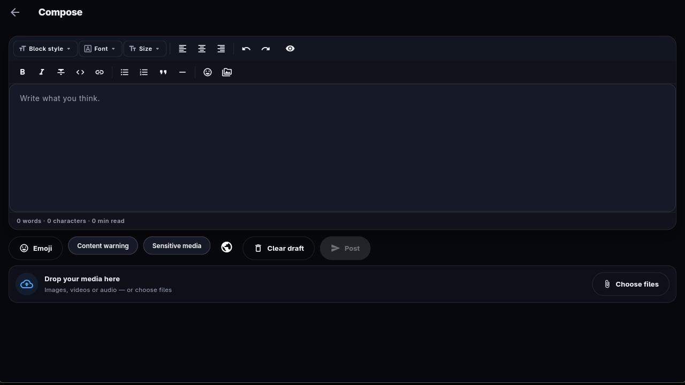
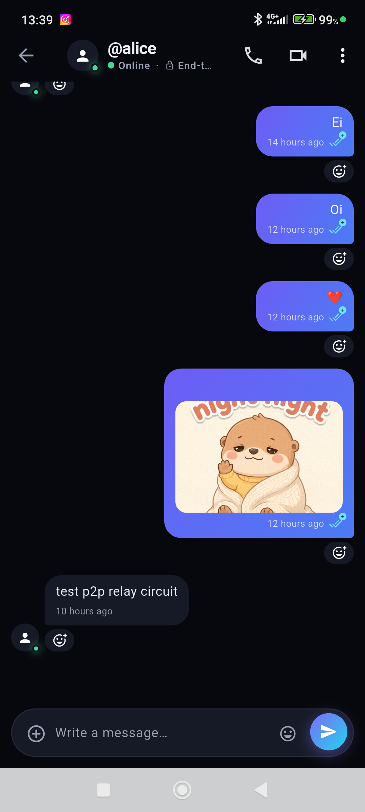
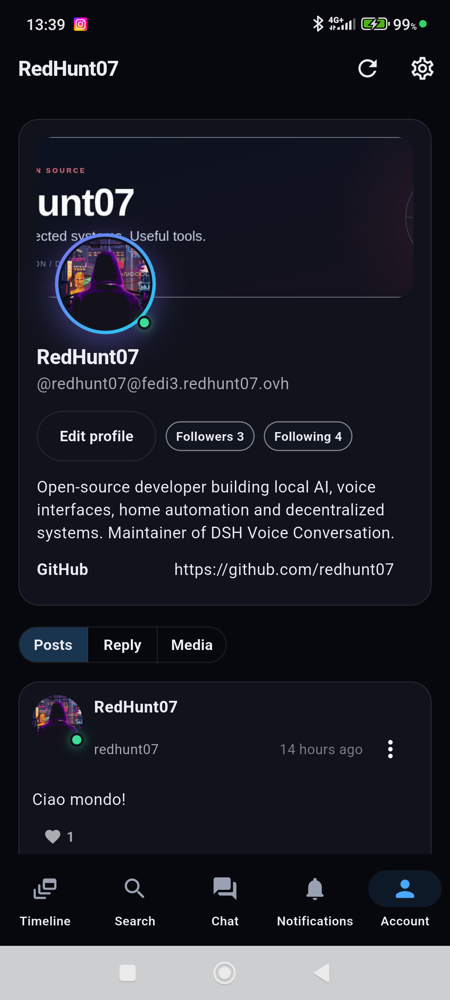
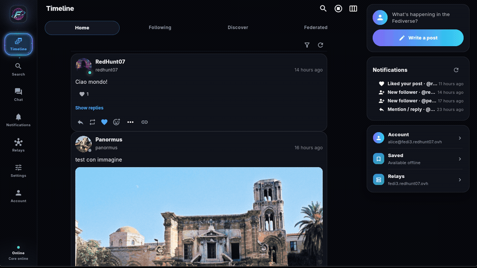
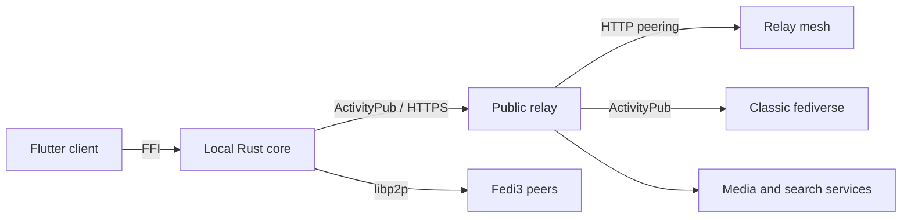

# FEDI3

[](https://github.com/redhunt07/Fedi3/actions/workflows/ci.yml) [](https://github.com/redhunt07/Fedi3/releases) [](LICENSE) [](Cargo.toml) [](app)

Maintainer: **[RedHunt07](https://github.com/redhunt07)** · **English** · [Italiano](README.it.md)



FEDI3 is a federated social platform with a peer-to-peer layer: privacy-first,
interoperable with the fediverse and resilient without giving up compatibility
with classic ActivityPub instances. It is a Flutter client backed by a local
Rust core, plus an optional public relay for federation and offline delivery.

> **Status: pre-1.0 — current release [0.11.11](https://github.com/redhunt07/Fedi3/releases/tag/v0.11.11) (build 4015).**
> Linux x86_64, Android arm64-v8a/x86_64 and Windows x64 builds are published on
> the release page with SHA256 checksums. Android APKs are sideload builds signed
> with the local debug key; iOS and macOS are buildable from source but are not
> part of the published packages. See [release verification](docs/audit/release_0.11.11_2026-11-12.md).

## Screenshots

Desktop client (Linux AppImage, English UI):

| Timeline | Chat |
| :---: | :---: |
|  |  |
| **Profile** | **Relays and telemetry** |
|  |  |
| **Settings** | **Composer** |
|  |  |

Android client:

| Timeline | Chat | Profile |
| :---: | :---: | :---: |
|  |  |  |

Animated tour of the desktop client:



## Contents

- [What it is](#what-it-is)
- [Features](#features)
- [Architecture](#architecture)
- [Requirements](#requirements)
- [Quick start: relay](#quick-start-relay)
- [Client installation](#client-installation)
- [Development and testing](#development-and-testing)
- [Documentation](#documentation)
- [Security](#security)
- [Contributing](#contributing)
- [License](#license)

## What it is

FEDI3 combines a local Rust core, a Flutter client and a public relay:

| Component | Path | Responsibility |
| :--- | :--- | :--- |
| Flutter client | `app/` | UI, timelines, composer, chat, calls, media, settings |
| Local Rust core | `crates/fedi3_core` | ActivityPub, HTTP signatures, end-to-end chat, cache, P2P transport, relay tunnel; loaded by the app through `dart:ffi` |
| Public relay | `crates/fedi3_relay` | Federation compatibility, routing, media, search, spool for offline users, relay mesh |
| Shared protocol | `crates/fedi3_protocol` | Types and models shared by core and relay |
| P2P infrastructure | `crates/fedi3_p2p_infra` | Mailbox and circuit-relay services |
| Deployment assets | `deploy/` | PostgreSQL, Meilisearch, Redis, coturn, P2P node, TLS |

The relay never sees private keys: signing and decryption happen in the local
core. Federated ingress requires a valid HTTP signature bound to the declared
actor, and the local core is protected by an internal token and listens on
loopback by default.

## Features

**Client**

- Home, following, discover and federated timelines with media, reply and boost
  filters; profile pages with banner, avatar, fields and paginated posts.
- Composer with MFM formatting, content warnings, sensitive-media flags and
  multi-media attachments; visibility controls for public, unlisted, followers
  and direct notes.
- End-to-end encrypted 1:1 and group chat with reactions, stickers, files, read
  receipts, presence and Telegram-style conversation creation.
- Audio and video calls with ICE/TURN fallback, screen sharing with system audio
  on desktop, and front/back camera switching on Android and iOS.
- Notifications for activity, chat and incoming calls, with distinct sounds and
  a keep-alive service that survives when the app is closed on Android.
- Saved posts available offline, global search, hashtag discovery and an
  integrated media viewer.
- Settings for appearance and language, privacy, moderation, networking, audio
  devices, backup/export and verified client updates.

**Network**

- Local core with ActivityPub actor, outbox/inbox, HTTP signatures and media
  storage; a P2P-only mode works without a relay.
- libp2p transport: identify, DHT, relay reservation, DCUtR, AutoNAT, mDNS,
  gossip and peer exchange, with known-peer persistence.
- Relay mesh over HTTP for relay-to-relay discovery and note sync, plus a shared
  [relay directory](relays/relays.json) with latency ranking.
- Relay compatibility for classic fediverse instances, including migrated
  accounts and outbox normalization.

**Security**

- Private keys stay on the device; the relay never sees them.
- Federated ingress requires a valid HTTP signature bound to the declared actor.
- The local core is protected by an internal token and binds to loopback by
  default; client tokens live in the OS keyring.
- Chat is end-to-end encrypted with AES-256-GCM and Kyber768-derived keys
  (no forward secrecy: documented limitation).
- Outbound federation fetches enforce SSRF protection, bounded redirects and
  body caps.

## Architecture



The client talks to the local core over FFI; the core owns identity, signing,
encryption and storage, and reaches the network through the relay tunnel or
direct P2P. The relay is a stateless federation front end with a database and a
media backend; it can be deployed alone, with P2P infrastructure, or behind
YunoHost. Read [decentralization](docs/decentralization.md),
[P2P network](docs/p2p_network.md) and [interoperability](docs/interop.md).

## Requirements

- Rust stable (the workspace is built and tested with the current stable toolchain).
- Flutter 3.38 or newer for the client.
- Linux desktop dependencies for the AppImage: `clang`, `cmake`, `ninja`,
  `pkg-config`, `libgtk-3-dev`, `libsecret-1-dev`, `libjsoncpp-dev`, `libmpv-dev`,
  `libasound2-dev`, `libpulse-dev`, `libwebkit2gtk-4.1-dev`. See [Linux build guide](docs/build_linux.md).
- Docker and Docker Compose for the relay stack.

## Quick start: relay

Automated server install for Debian/Ubuntu and Arch derivatives (relay + P2P,
relay only or P2P only):

```bash
sudo git clone https://github.com/redhunt07/Fedi3.git /opt/fedi3
cd /opt/fedi3
sudo bash scripts/install_server.sh
```

See [server installation](docs/deploy_server.md) for the step-by-step guide,
or [YunoHost installation](docs/deploy_yunohost.md) when nginx already owns
ports 80/443. The manual configuration follows.

```bash
cp .env.example .env
# Edit .env: at least FEDI3_DOMAIN, FEDI3_RELAY_ADMIN_TOKEN (>= 32 chars)
# and FEDI3_RELAY_PG_PASSWORD. The template starts relay,p2p,caddy; add turn
# to COMPOSE_PROFILES (and set TURN_*) for calls, search for Meilisearch.
# Behind YunoHost use COMPOSE_PROFILES=relay,p2p (no caddy).
# Leave FEDI3_RELAY_DB_URL empty: PostgreSQL credentials are composed automatically.
docker compose up -d --build
scripts/relay_smoke_test.sh https://relay.example.com <ADMIN_TOKEN>
```

Full configuration, TLS and monitoring: [relay deployment](docs/deploy_relay.md)
and [VPS deployment](docs/deploy_vps.md).

## Client installation

Linux (Debian/Ubuntu):

```bash
curl -fsSL https://raw.githubusercontent.com/redhunt07/Fedi3/main/scripts/install_deb.sh | bash
```

Linux (Arch and derivatives):

```bash
curl -fsSL https://raw.githubusercontent.com/redhunt07/Fedi3/main/scripts/install_arch.sh | bash
```

Both installers accept `--update-only` to update without reinstalling
dependencies.

Windows (PowerShell):

```powershell
powershell -ExecutionPolicy Bypass -Command "iex (iwr -useb https://raw.githubusercontent.com/redhunt07/Fedi3/main/scripts/install_windows.ps1); Install-Fedi3"
```

Add `-UpdateOnly` to `Install-Fedi3` for an update-only run. Administrator
privileges are required to install dependencies through winget/BuildTools; the
core is installed as the Scheduled Task `Fedi3 Core`.

The client stores tokens in the OS keyring: Linux builds require `libsecret`
and a running Secret Service. An AppImage can be built locally with
`scripts/build_appimage.sh release`.

Android: download `app-arm64-v8a-release.apk` for a 64-bit ARM phone or
`app-x86_64-release.apk` for an x86_64 emulator from the release page, verify
`checksums.txt`, then allow installation from that source. Android installs
updates only when signing certificates match; keep the existing local signing
key for future builds. iOS/macOS packages are not included in this release.

Store-style channels are prepared in this repository: F-Droid metadata and build
recipe for Android, a Flatpak manifest for Linux desktops, and the AUR package
`fedi3-bin`. See [distribution packages](docs/distribution.md) for build,
submission and release-check instructions.

Available since 0.10.0: Settings → Client updates checks stable releases and
verifies SHA256 downloads. Linux x86_64 AppImages can replace themselves with a
backup; Windows x64 uses a verified ZIP and guided installation. Earlier clients
need a manual first upgrade. See [client updates](docs/updates.md).

## Development and testing

```bash
# Rust
cargo fmt --all -- --check
cargo clippy --workspace --all-targets --locked -- -D warnings
cargo test --workspace --locked

# Flutter
cd app
flutter pub get
flutter analyze --fatal-infos
dart format --output=none --set-exit-if-changed lib test
flutter test

# Platform configuration (Android manifest, macOS entitlements, iOS Info.plist)
bash scripts/verify_platform_config.sh
```

The suite does not require Docker or external services: the relay is tested
against SQLite and remote peers are in-process HTTP servers. The optional
PostgreSQL quota test runs in CI with an ephemeral database. Deployment scripts
and the OpenAPI contract are validated by `scripts/tests/` in CI.

## Documentation

English (default):

- [Getting started](docs/getting_started.md)
- [Server installation, Debian and Arch](docs/deploy_server.md)
- [Fedi3 relay on YunoHost](docs/deploy_yunohost.md)
- [Relay deployment](docs/deploy_relay.md)
- [Relay directory](docs/relay_directory.md)
- [Local core and P2P mode](docs/deploy_core.md)
- [VPS deployment](docs/deploy_vps.md)
- [Decentralization model](docs/decentralization.md)
- [P2P network](docs/p2p_network.md)
- [Network resilience](docs/network_resilience.md)
- [Push-forward receipts](docs/push_forward_receipts.md)
- [Interoperability](docs/interop.md)
- [Linux build](docs/build_linux.md)
- [Distribution packages](docs/distribution.md)
- [App guide](docs/app_guide.md)
- [Client updates](docs/updates.md)
- [Client UX plan](docs/client_ux_plan.md)
- [Backup and restore](docs/ops_backup_restore.md)
- [Troubleshooting](docs/troubleshooting.md)
- [FAQ](docs/faq.md)
- [Test plan](docs/test_plan.md)
- [Relay sync API](docs/relay_sync_api.md)
- [OpenAPI specification](docs/openapi.yaml)
- [Announcements](ANNOUNCEMENTS.md) and [changelog](CHANGELOG.md)
- [Release verification 0.11.11](docs/audit/release_0.11.11_2026-11-12.md)

Italian counterparts: [`docs/it/`](docs/it/README.md).

## Security

- Private keys stay on the device; the relay never sees them.
- Federated ingress requires a valid HTTP signature bound to the declared actor.
- The local core is protected by an internal token and binds to loopback by default.
- Chat is end-to-end encrypted without forward secrecy (documented limitation).
- Outbound federation fetches enforce SSRF protection, bounded redirects and body caps.
- Client tokens are stored in the OS keyring; Linux needs a running Secret Service.

Please report vulnerabilities privately: see [SECURITY.md](SECURITY.md).

## Contributing

Read [CONTRIBUTING.md](CONTRIBUTING.md) before opening a pull request. Useful
contributions include reproducible bug reports, protocol/interop tests,
documentation fixes and focused, reviewable changes. Documentation is bilingual:
English in `docs/`, Italian in `docs/it/`. This project follows the
[Contributor Covenant](CODE_OF_CONDUCT.md).

## License

AGPL-3.0-or-later. See [LICENSE](LICENSE) and [NOTICE](NOTICE). Modifications to
network-exposed parts must remain open source.
