# FEDI3 app guide

FEDI3 is made of two parts that run on your machine:

- the Flutter **app**, which is the interface;
- the local Rust **core**, which handles identity, cryptography, cache and federation.

The core listens on `127.0.0.1` and is protected by an automatically generated internal token. The relay is optional: without a relay you can still use P2P and chat, but you are not reachable from traditional fediverse instances.

## Screenshots

Desktop client (Linux AppImage, English UI):

| Timeline | Federated | Chat |
| :---: | :---: | :---: |
|  | 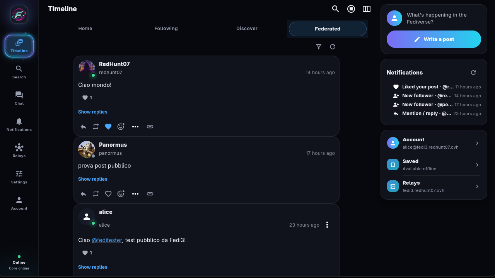 |  |
| **Search** | **Notifications** | **Profile** |
| 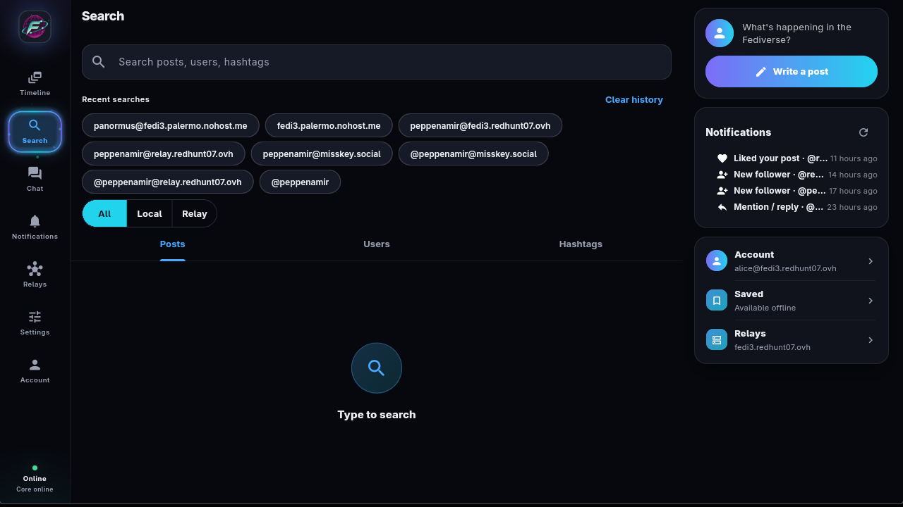 | 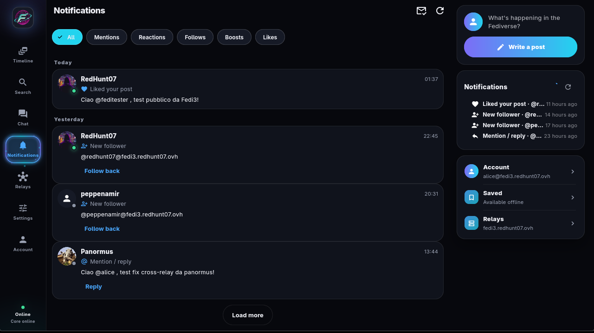 | 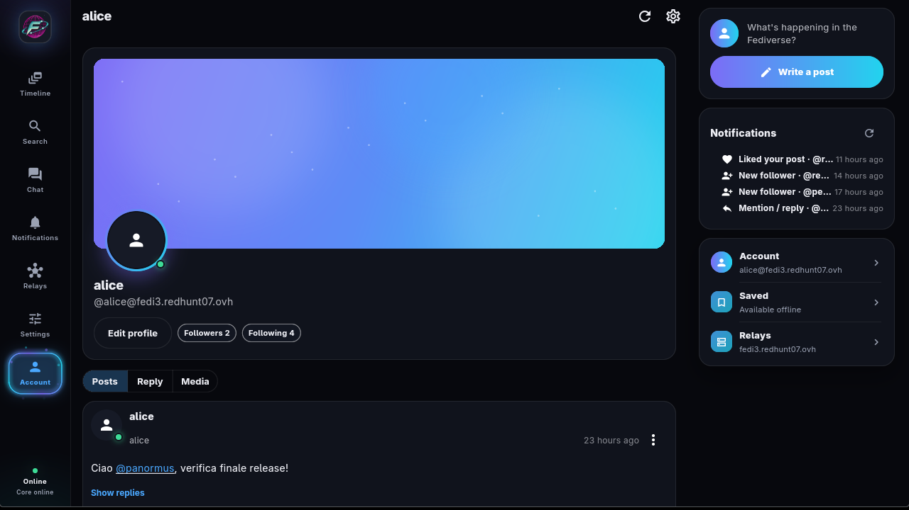 |
| **Relays** | **Settings** | **Composer** |
| 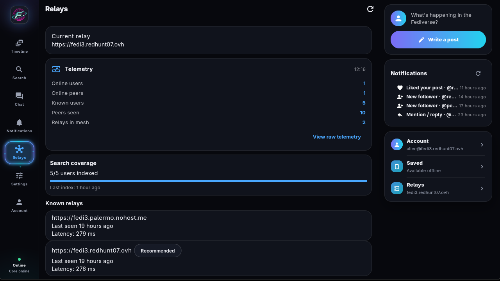 | 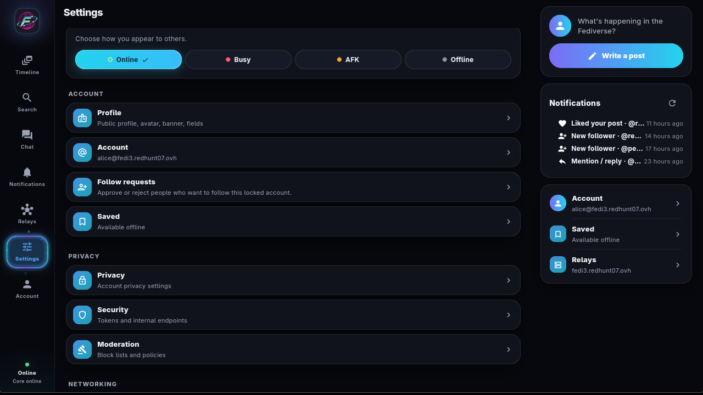 | 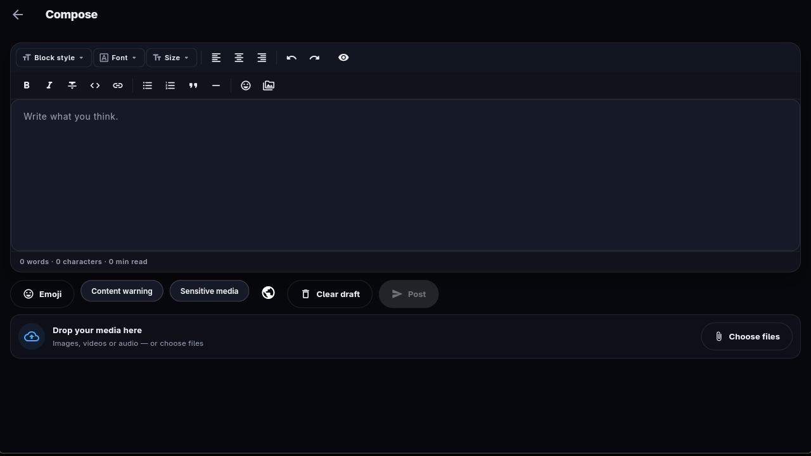 |

Android client:

| Timeline | Chat | Profile |
| :---: | :---: | :---: |
|  | 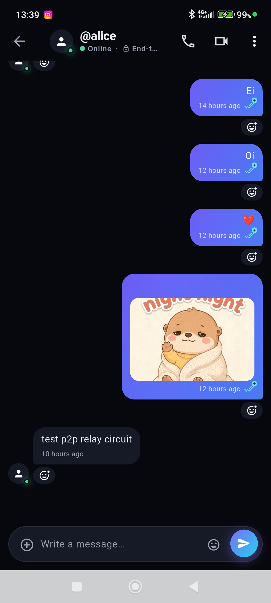 | 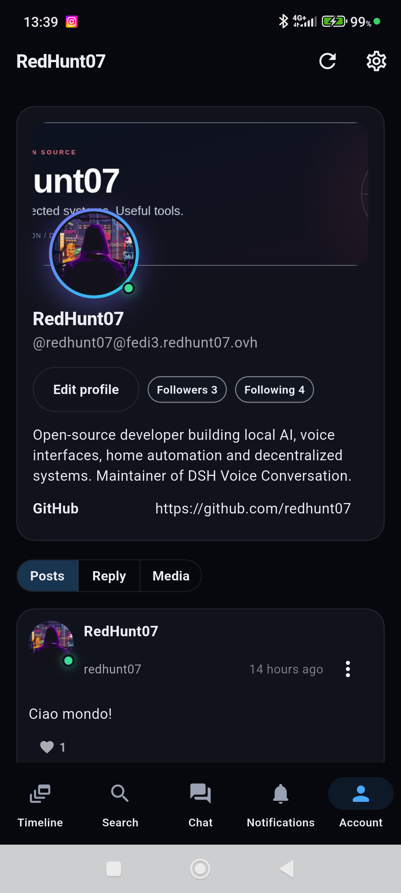 |
| **Chat list** | **Settings** | |
| 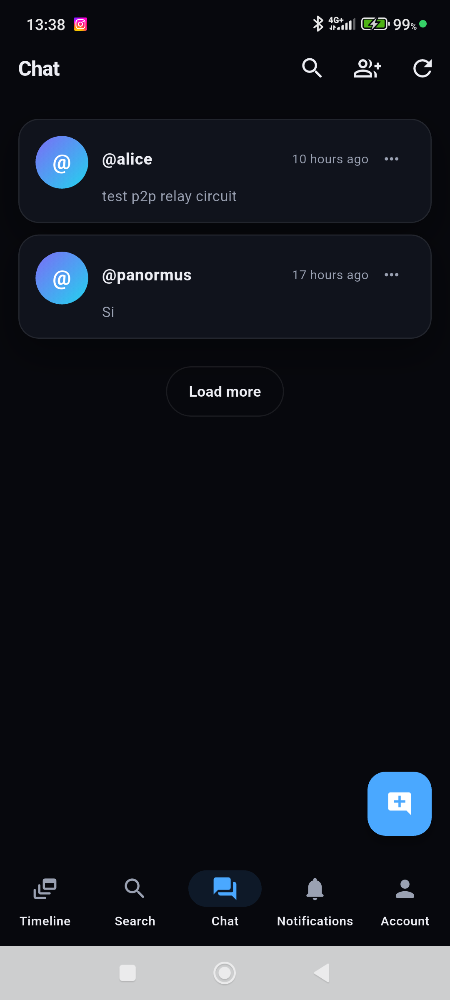 | 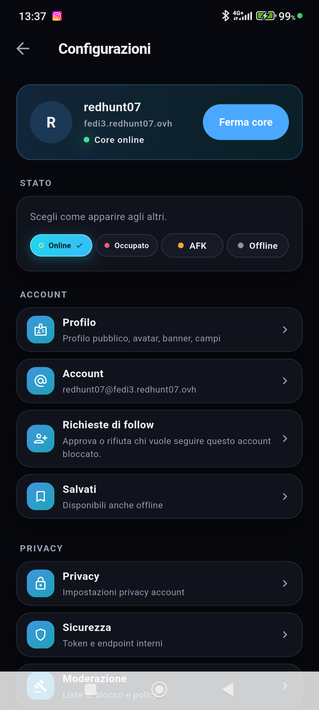 | |

Animated tour of the desktop client:

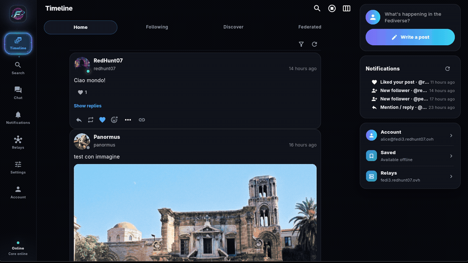

## First start

1. Open the app. If no configuration exists, the welcome screen is shown.
2. Fill in:
   - **Public domain**: the hostname through which you want to be reachable (e.g. `my.name`). It must point to your instance or to the relay you use.
   - **Username**: only letters, digits and `_`, from 1 to 64 characters. It cannot be changed without migrating the account.
   - **Local bind**: leave `127.0.0.1` unless you want to expose the core on the LAN.
   - **Relay**: relay URL (`https://relay.example.org`) and the token obtained from registration. You can leave it empty for a P2P-only mode.
3. Press **Start**. The app waits for the core to actually be listening before showing the timeline. If the core does not start, the error is shown in the setup screen.

## Branding

The Fedi3 mark is the neon retro F over an orbital globe. It appears on the
welcome screen and in the shell, and it is the launcher icon on desktop,
Android, iOS, macOS and Windows.

## Configuration storage

The configuration is saved atomically in the app data directory, with `600` permissions on POSIX. If the file is corrupted, the app tries to recover it from the backup and, if it fails, warns you instead of silently overwriting.

## Timeline

- Federated, local and "following" timelines are separate.
- Quick filters let you see only media, only replies or only boosts.
- Actions (like, boost, reply, delete) are available from the note menu.
- The federated timeline polls public posts from followed accounts, including pending follow requests; the home timeline shows them only after the follow is accepted.
- Profile pages keep the posts authored by that account and merge the public posts cached by the local core, ignoring activities from another identity.
- Media open in the integrated viewer: swipe to navigate, tap to toggle audio.

## Publishing

- The composer accepts text, media and visibility (public, unlisted, followers, direct).
- The text is always converted to HTML with escaping: the characters `<`, `>`, `&`, `"` and `'` do not break rendering nor open injection.
- MFM syntax (`**bold**`, `:emoji:`) is supported.
- Direct notes do not appear in the public outbox.

## Chat

- Chats are 1:1 or group. Delivery prefers the P2P circuit; when that is unavailable the envelope is posted over HTTPS to the peer's relay path (`/users/<name>/_fedi3/chat/inbox`), so chat works in relay-only deployments too. The message body stays end-to-end encrypted either way.
- Chat messages use AES-256-GCM with per-message keys derived from Kyber768 through HKDF-SHA256 and RSA-SHA256 signatures. The relay does not see the chat content. RSA-OAEP is used separately for compatibility/spool envelopes.
- It supports reactions, files, GIFs and read status.
- The notification service declares `remoteMessaging` on Android 14+ (falling back to
  `dataSync` below): Android 15 caps `dataSync` foreground services at six hours per day.
- On Android the settings backup is written to a temporary JSON file and handed
  to the system share sheet (Files, Drive, mail); the clipboard stays as a
  fallback when sharing is unavailable.
- Following someone also backfills their recent public posts into the home
  timeline; Fedi3 peers are polled through the relay like classic servers.
- Chat envelopes for a member that is offline are queued in the sender core and
  retried while it runs (bounded backoff); the recipient dedupes by message id.
- Decorative animations (presence glow, selection ring, brand mark) run for a
  few cycles and then settle: a static screen does not render at 60fps, so
  idle CPU stays near zero and battery use is minimal.
- Activity, chat and call notifications use three distinct bundled sounds based on Discord's message, mention and call-ring tones.
  Activity notifications are raised by the app shell too, so they reach the
  notification shade while the user is on another tab.
  (`res/raw/fedi3_activity`, `fedi3_chat`, `fedi3_call`).
- Incoming calls ring with a system notification while the app is in the background; the
  call prompt opens as soon as the app is brought forward.
- Screen sharing needs a `mediaProjection` foreground service on Android; the app starts
  `ScreenShareService` before requesting the projection and stops it when sharing ends.
- Calls use WebRTC between clients. Android needs `ACCESS_NETWORK_STATE` and `ACCESS_WIFI_STATE`: without them the WebRTC network monitor throws and aborts the process on the first call.
- Calls need a reachable TURN relay when a peer is behind a VPN or carrier-grade NAT: STUN only discovers addresses and cannot relay media. The client derives `turn:` endpoints from the relay host when ICE credentials are configured, and the relay publishes its coturn pool to authenticated accounts (`FEDI3_RELAY_TURN_*`). Offers and answers carry the candidates gathered in a short window; a failed media path triggers up to two automatic ICE restarts and then offers a Retry action. Signaling can complete while media fails: the call screen shows the ICE state, not just "answered".
- On desktop, **Settings > Audio** selects the microphone and the output used by calls and tests them. The microphone test records five seconds with a live level meter and plays the recording back on the chosen output; the output test plays a short tone without changing the system-wide default. A missing device falls back to the system default at call time. On Linux the AppImage uses the host GStreamer and PulseAudio/PipeWire stack for playback and routing; install `gstreamer` with its base/good plugins and `pipewire-pulse` or `pulseaudio`. Screen sharing keeps the microphone and adds the PC system audio as a second track, so the far end hears both. The system audio comes from the default output: when no call output is chosen, the app moves the call to another device for the duration of the share, so the other side does not hear its own voice through the loopback; an explicitly chosen output is kept. Camera video is shown with its native aspect ratio instead of being cropped to the tile. On Android and iOS, video calls have a button to switch between the front and back camera.
- Photos, files, voice notes and video messages can be sent in the chat. A message may carry only an attachment, without text. Audio attachments play inline with a progress bar and duration; video messages show a poster frame and play in the bubble. Video notes are recorded video-only (voice is covered by audio notes) because the Android muxer otherwise writes empty files; a recording that ends up empty is discarded with a clear message instead of uploading an empty body. A failed send keeps the draft and shows the error with a retry action.
- Creating a group announces it to the selected members with a system payload (member list and title), so every participant gets the thread before the first message. Group events (created, renamed, member added/removed, left, deleted) appear as centered notices in the conversation.
- Only groups can be renamed; direct chats always show the other person's handle. Roles are owner/admin/member, and message actions (react, reply, forward, pin, edit, delete) are available from a long press.
- Known limit: there is no *forward secrecy*. If a private key is compromised, past messages become readable.

## Notifications

- Notifications are local; no external push service is needed.
- On Android the `POST_NOTIFICATIONS` permission is needed (requested on startup) and the `INTERNET` permission.
- Android keeps a foreground service running while the app is in the background. The service hosts a headless Flutter engine that polls the relay chat spool and starts the local core only when there is something to deliver; the core then posts chat, call and activity notifications and stops again after a quiet period, so no core or P2P swarm stays alive while idle. It is controlled in **Settings > Security > Background notifications**; a small persistent notification is shown while it runs.
- UnifiedPush (when the relay exposes a push provider) covers the case where Android reclaims the process.
- The notification list updates at the top without clearing those already read.

## Settings

- **Security**: relay token, key rotation, profile visibility.
- **Privacy**: telemetry consent (optional), media cache, per-domain blocking.
- **Moderation**: lists of blocked actors and domains.
- **Backup**: export and import configuration and preferences as an encrypted JSON file (AES-GCM, passphrase of at least 12 characters). The backup does **not** contain the private key: that lives in the core data directory and must be saved separately if you want to be able to migrate.
- **Language**: Italian and English.

Every change to the configuration restarts the core and waits for it to be ready. If the new value does not work, the app restores the previous configuration.

## Installing Android 0.11.10

From the [v0.11.10 release](https://github.com/redhunt07/Fedi3/releases/tag/v0.11.10), download
`app-arm64-v8a-release.apk` for 64-bit ARM phones or
`app-x86_64-release.apk` for x86_64 emulators and verify its SHA256 against
`checksums.txt`. These are sideload builds signed with the local debug key,
not Play Store distributions. Updating an existing installation requires the
same certificate. Export a backup from settings first if you need to change
certificates and reinstall. 32-bit ARM devices are unsupported.

## Android build and emulator

- `scripts/build_android.sh debug` compiles the core for `arm64-v8a` and `x86_64` and produces a debug APK. `profile` does the same with an AOT build, useful to measure realistic performance on an emulator.
- `scripts/build_android.sh release` builds the core for `arm64-v8a` and `x86_64` and produces per-ABI APKs. The `arm64-v8a` APK is the one to distribute (about 70 MB); the `x86_64` APK can be installed on an emulator; the `armeabi-v7a` APK is dropped because the core is not built for 32-bit ARM. Without `android/key.properties` the release APK is signed with the debug key.
- Stale native libraries from an earlier profile are removed before each build, so a release APK never carries emulator-only ABIs.
- Requirements: Android SDK, NDK 28.2.13676358, and a full JDK 17 (`javac` is required; a JRE alone fails the Gradle build).
- Android exposes no `HOME` directory, so the app stores its configuration in the app support directory and passes an explicit `data_dir` to the core. Both paths stay inside the app sandbox.
- Emulator: start an `x86_64` AVD and run `flutter run -d emulator-5554` (or install the debug APK with `adb install`). The debug APK already contains the x86_64 core.
- The relay registers a username on the first tunnel connection. If a username already exists with another token, the tunnel is rejected: use a new username or rotate the token through the relay admin API.
- Measured on a release build (x86_64 emulator, 4 GB RAM): cold start about 0.5 s, PSS about 130 MB in the foreground and 145 MB with the background notification service, background CPU about 0.2% of one core. The Flutter raster thread reports about 50% CPU on the emulator because the guest falls back to software rendering; that figure is not representative of a real device with a GPU.

## Common problems

| Symptom | Probable cause | Remedy |
|---|---|---|
| "Core not started" | port already in use or invalid username | change the bind or fix the username |
| Empty timeline | relay unreachable or wrong token | verify the token in settings |
| No incoming federation | public domain does not resolve to the relay | check DNS and the tunnel |
| Endless spinner | the core is not responding | the app detects the failure within a few seconds and attempts a restart |
| Media not visible | relay media backend not configured | check `FEDI3_RELAY_MEDIA_BACKEND` |
| Chat message stays on the clock | peer unreachable over both P2P and relay | check the peer's relay tunnel and `fedi3.log` in the core data directory |

Native core diagnostics are appended to `fedi3.log` in the core data directory (next to `fedi3.db`); on Android that file is the only place where core logs are visible.

For the relay see [deploy_relay.md](deploy_relay.md) and [troubleshooting.md](troubleshooting.md). To build the app from source see [build_linux.md](build_linux.md).

### Credentials and Linux keyring

Linux builds require `libsecret` and an active Secret Service in the user
session, for example GNOME Keyring or KWallet with the Secret Service
enabled. To build, install `libsecret-1-dev` and `libjsoncpp-dev` on
Debian/Ubuntu, or `libsecret` and `jsoncpp` on Arch.

If the keyring is locked or unavailable, Fedi3 shows a recovery screen:
unlock the keyring and press **Retry**. The program keeps configuration and
account and does not propose creating a new profile in this condition. A
corrupted JSON is reported separately. Do not delete `config.json` to solve a
keyring problem.
