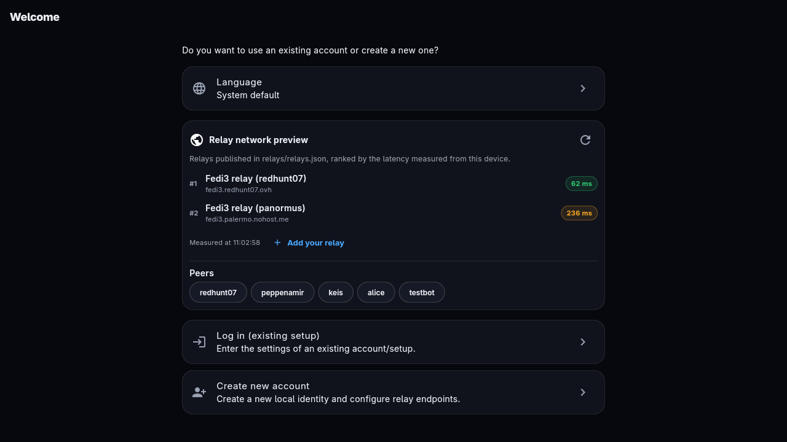

# Release preparation — 15 November 2026

Source version: **0.12.2+4018**. Git base: `1abb4d2`, branch `main`, with
uncommitted local edits. This report describes a local candidate, not a published
release or certification of every possible execution path.

## Corrections

- The Android service's plaintext private cache was also written on desktop and
  could bypass locked-keyring recovery. Reading/writing it is now Android-only.
  Successful vault access removes legacy desktop copies and temporary files;
  unavailable vaults retain them for recovery without loading them. Regression
  tests cover cleanup and locked-vault behavior.
- Quick login discarded explicit ports when converting HTTP to WebSocket.
  Conversion now uses `Uri.replace`, with HTTP/HTTPS custom-port regressions.
- Fixed large-text overflow in startup messages/actions, relay selection,
  delivery menus and core status. Startup, onboarding, pairing and settings use
  the shared 720-pixel desktop content width.
- Configured push hostnames were not passed into Caddy. Compose now forwards
  them; reserved fallback hosts are HTTP-only, avoiding certificate requests
  for `*.invalid`. Overrides and Caddy's adapted configuration were verified.
- Aligned NOTICE, README, policies, Rust metadata and badges with the owner's
  selection of **AGPL-3.0-only**, with a license contract test. The standard
  LICENSE text and dependency licenses retain their respective terms.
- Corrected build/update guides, documented replication contracts in English,
  translated identified Italian core/script comments and updated agent notes.
  Added bilingual release procedures, CI link/guide checks and the repeatable
  `scripts/verify_release.sh` entry point.

## Automated evidence

| Gate | Result |
| --- | --- |
| Rust format, workspace/all-target clippy with `-D warnings`, locked build | Passed |
| `cargo test --workspace --locked -- --test-threads=4` | 351 passed; 4 ignored in the normal suite |
| Previous RSA/WebRTC compatibility | 2 normally ignored tests explicitly run and passed |
| Atomic PostgreSQL quota | Normally ignored test passed against isolated PostgreSQL 16 |
| Flutter format and `analyze --fatal-infos` | Passed; no issues |
| `flutter test --reporter expanded` | 272 passed |
| Responsive layouts | 12 combinations: 3 widths × 2 languages × 2 themes, 200% text, four screens |
| Compose/OpenAPI, release, relay directory, backup, AppImage ABI and documentation contracts | Passed |
| Signed APT repository | Passed in Debian 12 with dpkg/GnuPG; skipped on the host due to missing tools |
| Platform configuration and ShellCheck | Passed |
| `cargo audit` | No blocking vulnerabilities; 5 maintenance warnings |
| `git diff --check`, `git fsck --no-reflogs` | No errors; dangling objects retained |

Rust coverage includes real relay/core federation, account synchronization,
notification replication, spools, ActivityPub security and authentication
regressions. Widget HTTP/runtime are simulated. Public IPFS bootstrap was not
run. These checks are not new Mastodon/Misskey interoperability tests or tests
of prolonged Android Doze.

RustSec maintenance warnings concern `paste`, `pqcrypto-internals`,
`pqcrypto-kyber`, `pqcrypto-traits` and `rustls-pemfile`. Monitor them and plan
compatible cryptographic migration rather than arbitrary pre-release changes.
Android emits warnings about future plugin migration to Built-in Kotlin;
verification used the repository's pinned toolchain.

## Local builds and packages

Flutter 3.50.0 / Dart 3.14.0, Rust 1.99.1, Linux x86_64. Initial PATH resolution
selected a CMake wrapper with a missing interpreter; the build used an installed
CMake binary without modifying the user's environment files.

- Native core and Linux release bundle built successfully.
- `NO_BUMP=1 bash scripts/release_full_linux.sh` succeeded. AppImage startup in
  isolated D-Bus/Xvfb/XDG directories displayed a first frame and stayed alive;
  its screenshot was visually inspected. This local test does not replace CI's
  Ubuntu 22.04/24.04 AppImage checks.
- `bash scripts/build_android.sh release` built arm64-v8a and x86_64 APKs.
  `apksigner verify --verbose` verifies both (v2 signature scheme). `aapt`
  reports 0.12.2, versionCode 6018/8018. Each packaged core's 23 allocated ELF
  sections match the newly compiled core. Gradle strips non-runtime sections,
  so whole-library hashes differ.
- Relay Docker image built and ran in a temporary container: `/healthz` and
  `/readyz` returned 200; unauthenticated metrics returned 401. Test databases
  and containers were removed. Production was not deployed.

| Package | SHA256 |
| --- | --- |
| `dist/Fedi3-linux-x86_64.AppImage` | `ad26a4e7af457ed78c2850289844e4bfe886c79dbaf86e2a14acfc61ff064eee` |
| `app/build/app/outputs/flutter-apk/app-arm64-v8a-release.apk` | `c3df7e9652d5837ba0a87fd0ad0a2bfd757f990d92a650ba114fbd0720bb1ecb` |
| `app/build/app/outputs/flutter-apk/app-x86_64-release.apk` | `9cb0a2e99d9936e0f847e0407b9bf1f0c83186c8a09eafc9cb376cd48c79ead9` |

## Git and stable-release conditions

The nine pre-existing edits to `.env.example`, Caddyfile, Dockerfile and
deployment guides were preserved. New changes remain in the working tree;
no commit, push, tag or publication was performed. Remote tag inspection showed
`v0.12.0` and `v0.12.1`, without `v0.12.2` at the time of verification.

The candidate passes the documented local gates. Before stable publication:

1. Review the entire diff and create the final commit with consistent version,
   notes and license. Tags and packages must identify that commit.
2. Obtain complete CI results for that commit, including Windows builds and
   Ubuntu 22.04/24.04 AppImage startup. Windows/macOS/iOS were not built here.
3. Test the new APKs on real devices, including update signing continuity,
   pairing, keyring/Keystore, calls, media and background notifications. Valid
   APK signatures do not prove compatibility with every existing installation;
   no real installation was updated in this session.
4. Repeat interoperability and backup/restore checks using the packages for
   the selected channel. Historical reports are not new tests of these binaries.

Repeatable procedure: [release checklist](../release_checklist.md).
