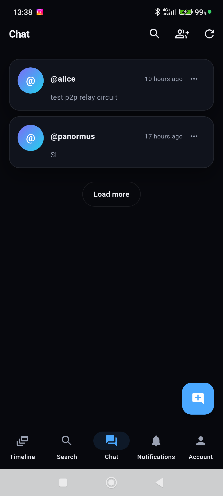
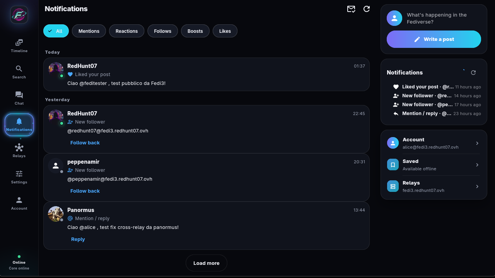
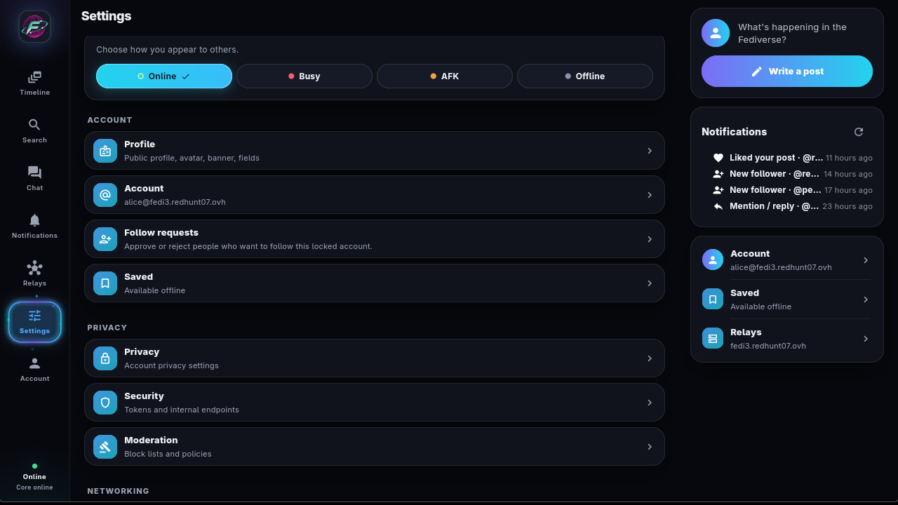
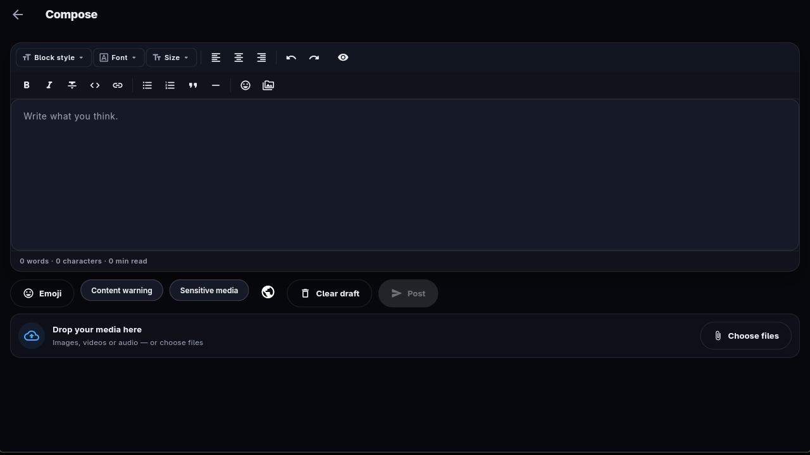
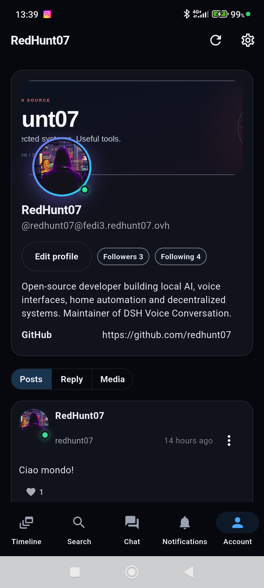
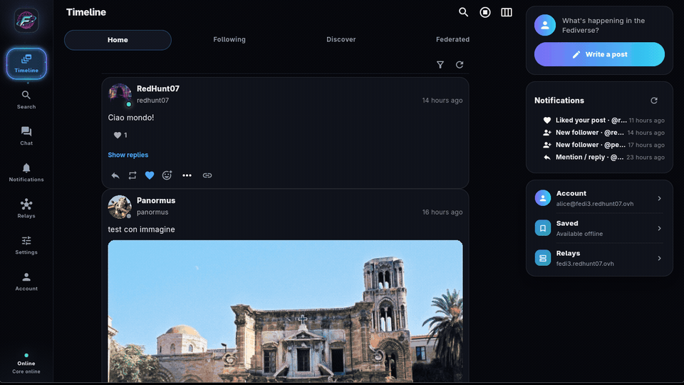

# Fedi3 — Client relaunch plan (UX/IA)

Date: 2026-11-01. Last status update: 2026-11-09, client 0.11.9+2012.
Status: adopted; steps 0–7 are implemented in the 0.11.x client, step 8 is in
progress. Sections 1–9 preserve the original plan; sections 10–12 track the
current client and the remaining work.

## 1. Honest assessment

This section describes the client at the start of the relaunch (2026-11-01).

The current client **is not yet appealing** for a user coming from Mastodon,
Misskey or mainstream social networks. Not because of Flutter: because of the product.

Defects observed in the live verification:

- onboarding is an administrator panel (bind, internal token, relay WS,
  domain) instead of a "choose a name and start" flow;
- the desktop timeline opens four columns with misleading labels: the "Local" column
  actually shows the follow feed, "Social" is empty without P2P;
- the profile shows raw activities (`EmojiReact`, `Like`, `Follow`) mixed with
  notes, without Post/Replies/Media tabs;
- follower/following lists were missing (now added), pagination, useful empty states;
- settings present but hard to discover, without internal search or a clear
  hierarchy;
- no visual identity, no guided onboarding, no account recovery path
  explained to the user;
- chat is technically E2E but poor compared to Misskey (attach files, react,
  threads, read status).

The problem is not "the wrong language": it is **information architecture,
flows and finish**. Rewriting in another language without solving these points
would produce the same product at a higher cost.

## 2. What to copy from Misskey and what not to

Misskey is a useful reference for **structure**, not for density.

To copy:

- settings taxonomy (Account, Profile, Privacy, Security, Moderation,
  Network, Appearance, Notifications, Language, Backup, About) with subpages and search;
- profile with tabs (Posts, Replies, Media, Reactions) and clickable counters;
- **optional** deck/columns, not the default layout;
- composer always reachable, with visibility, attachments, emoji, polls;
- unified search with filters and history;
- grouped and filterable notifications;
- chat with attachments, reactions, threads and read status.

Not to copy uncritically:

- visual density and the number of options at first sight: Misskey is for power
  users; a new user gets lost;
- dependence on a centralized multi-user server: Fedi3 is single-user per
  core, so "login/registration" must be redefined (see §4);
- the all-web model: Fedi3 has a local core and a relay; the desktop client is
  an advantage, not a limit.

Recommended positioning: **IA inspired by Misskey, initial simplicity from
Mastodon, deck mode for those who want it**. Fedi3's competitive advantage remains
P2P/relay: the client must look normal before telling that story.

## 3. Language and platform: proposal

Do not rewrite now. Reasons:

- Flutter covers desktop, mobile and (with limits) web with a single codebase; the bottleneck
  is the product, not the runtime;
- the Rust core and the protocol are the asset: they must be stabilized with a documented client
  API, not rewritten;
- a complete rewrite would cost 2–3 months and freeze UX fixes.

Two-track proposal:

- **Track A (now)**: redesign of IA and flows in the existing Flutter client, step by step
  (§6). Every step is releasable and testable.
- **Track B (later)**: if web distribution is needed, a separate web client
  (React/TS or Svelte) that consumes the same API, sharing design tokens and not
  code. It is not a rewrite of the desktop: it is a second client.

If another language were chosen in the future, the condition is to have first
a stable and documented API: without that, every client stays coupled to the internal
endpoints.

## 4. Authentication: the architectural point to clarify

Today Fedi3 is **single-user per core**: the identity is a key, not an account with
a password. The app and the core run on the same machine and share an internal
token. This is not the Misskey model (multi-user, web sessions).

Three options, in order of cost:

1. **Local profile (recommended now)**: "registration" = identity creation
   (username + relay, advanced options hidden); "login" = import backup or
   connect to an existing instance (URL + token/backup). The client manages multiple
   local profiles with a switcher. No changes to the core.
2. **Remote access to the core**: the core exposes a client API authenticated with a bearer
   token over TLS, so a web client can connect to a remote instance. It requires
   CORS, dedicated tokens, OpenAPI and revocation.
3. **Multi-user in the core**: the real Misskey model, but it is a backend change
   (multiple identities, sessions, permissions). Deferrable.

Recommendation: start from (1), design the API to make (2) possible, do not
promise (3) until there is real demand.

## 5. Target information architecture

Routes and screens, in implementation order:

- `/welcome` — choice: create identity, import backup, connect instance.
- `/signup` — username, recommended relay, collapsed advanced options, mandatory and
  downloadable recovery code.
- `/login` — import backup, connect URL+token, recovery code.
- `/home` — single feed with Home/Local/Federated tabs, persistent composer,
  infinite scroll, filters, media.
- `/explore` — unified search (posts, users, hashtags), filters, history.
- `/notifications` — groups by type, filters, mark as read, real-time.
- `/messages` — conversation list, threads, attachments, reactions, read status.
- `/@user` — public profile with Post/Replies/Media tabs, follow, mute, block,
  report.
- `/me` — personal profile with tabs and editing, paginated follower/following lists.
- `/settings` — hub with subsections: Account, Profile, Privacy, Security,
  Moderation, Network, Appearance, Notifications, Language, Backup, About, Advanced.
- `/settings/*` — one page per category, with explicit save and core restart
  where needed.

Cross-cutting rules: no token/bind at first sight; every screen has an empty
state, an actionable error and a loading state; no raw activity shown
to the user except in "Show raw".

## 6. Step plan

Every step is a verifiable release; estimates are indicative (1 developer).

| Step | Content | Dependencies | Estimate | Acceptance criterion |
|---|---|---|---|---|
| 0 | UX audit, design tokens, navigation and route skeleton, startup gate | — | 2 d | routes and empty states present; no functional regression |
| 1 | Guided registration, recovery code, login (backup/connect), profile switcher | current config API | 3 d | new user publishes within 5 minutes without touching tokens |
| 2 | Single home with tabs, persistent composer, infinite scroll, media | core timeline | 4 d | usable feed on desktop and mobile; no misleading column |
| 3 | Own and other users' profiles with tabs, paginated lists, profile editing | relationships | 4 d | correct tabs and lists; consistent follow/unfollow |
| 4 | Settings with complete taxonomy, internal search, safe saves | existing screens | 3 d | all categories reachable in ≤2 taps |
| 5 | Unified search with filters, history, remote lookup | search API | 3 d | post/user/hashtag results; local fallback |
| 6 | Grouped notifications, filters, mark-read, real-time | event stream | 3 d | correct groups and filters; consistent badge |
| 7 | Complete chat: attachments, reactions, threads, read state | chat API | 3 d | conversation with media and read status |
| 8 | Finish: onboarding tour, accessibility, themes, i18n, shortcuts | — | 3 d | basic accessibility audit passed |

Total ≈ 28 days; the first three steps (0–2) already give a presentable client.

## 7. Backend work needed in parallel

- **Stable and documented client API** (OpenAPI): endpoints, typed errors,
  cursor pagination, versioning. It is the prerequisite for any future client.
- **Auth for remote access**: dedicated bearer token, CORS, revocation, rotation.
- **Pagination** for followers/following and notifications (today the client loads the first
  page).
- **Filtered profile feed** on the API or client side: only Notes, with tabs.
- **Grouped notifications** and server-side mark-read.
- **Chat**: attachments and read status if not already present.
- **Moderation**: mute/block/report exposed uniformly.

## 8. Risks and metrics

Risks: redoing the IA without user testing; introducing multi-user too early;
duplicating clients (desktop + web) without a shared API; regressions in P2P
functions during the restyling.

Metrics to measure: time to first post, success of the main tasks
(post, follow, reply, search), crash-free sessions, D1/D7 retention,
average time to find a setting.

## 9. Immediate proposal

Start with **Step 0 + Step 1** (navigation skeleton + guided registration/login),
because they are the entry gate and the most visible defect. In
parallel, write the minimal OpenAPI specification of the client API: without it,
Step 2 risks consolidating internal endpoints.

If the constraint is "copy Misskey", the sequence remains valid: copy the
taxonomy and the flows, not the density, and keep Flutter until the IA is
stable.

## 10. Current client (0.11.9+2012)

The shipped client is a Misskey-inspired desktop and mobile app built on the
Aurora design system: deep neutral surfaces, violet/cyan accents, an overlaid
profile header and a navigation rail with Timeline, Search, Chat, Notifications,
Relays, Settings and Account. It is no longer the administrator panel described
in §1.

| Desktop | Android |
|---|---|
|  |  |
|  |  |

Current behaviour by area:

| Area | Behaviour |
|---|---|
| Timeline | Home, Following, Discover and Federated tabs; filters; infinite scroll; federated media; composer with visibility, attachments and MFM toolbar. |
| Profiles | Banner behind the avatar, clickable counters, Posts/Replies/Media tabs, paginated outbox and follower/following lists with follow/unfollow. |
| Chat | Telegram-style bubbles with delivery/read check marks, E2E badge, recipient picker from mutual followers, group creation from the same screen, owner/admin/member roles, rename only for groups, message deletion, attachments, reactions, replies, forwarding, pinned messages, invite links, typing and presence. |
| Calls | E2E 1:1 and group audio/video calls over WebRTC, automatic TURN from the relay, screen sharing with microphone and PC system audio as separate tracks, selectable audio devices, ICE restart and a manual Retry action. Android/iOS switch between front and back camera; the Linux bridge reports `NotImplemented` for that switch. |
| Notifications | Grouped and filterable notifications, mark-as-read, real-time updates and three bundled sounds: timeline activity, chat and incoming call (Discord-style tones). Android uses a keep-alive foreground service with Android 15-compatible types. |
| Settings | Hub with Account, Profile, Privacy, Security, Moderation, Networking, Relays, UI, Translation, Audio, Backup, Advanced, Updates and Announcements; push is under Security on mobile. |
| Search | Posts, users and hashtags; all/local/relay source filter; persistent history with chips and clearing; global chat search. |
| Mobile | Android and iOS builds, UnifiedPush/APNs provisioning, notification sounds, single-task navigation, camera switching in video calls. |
| Updates | Verified client updates (SHA256) for the Linux AppImage, Windows ZIP and Android APK. |
| Accessibility | Keyboard shortcuts (Ctrl+1…7, Ctrl+N, Ctrl+F, Esc), accessible rail labels and empty/error states. |
| Localization | Bilingual English/Italian UI with ARB parity. |

More screens:

| | |
|---|---|
|  |  |
|  |  |

## 11. Progress status (2026-11-09)

| Step | Status | Notes |
|---|---|---|
| 0 — Audit, design tokens, skeleton, startup gate | completed | Aurora theme, custom rail, routes, empty states; a declarative router is still missing. |
| 1 — Guided registration/login, recovery | completed | identity/relay in the foreground, quick login from URL+token, collapsed advanced options and recovery code dialog. |
| 2 — Single home with tabs | completed | Home/Following/Discover/Federated, full-screen composer from the rail and mobile FAB. |
| 3 — Own/other profiles | completed (base) | banner overlay, counters, Posts/Replies/Media tabs, media grid, outbox pagination; advanced media filters are missing. |
| 4 — Settings | completed (visual) | grouped hub with icons and subpages; internal settings search is missing. |
| 5 — Search | completed (base) | posts/users/hashtags, source filter, persistent history; time filters are missing. |
| 6 — Notifications | completed | filters, mark-all-read, grouping by actor/type and date, real-time badge. |
| 7 — Chat | completed | threads, attachments with preview, reactions, read state, E2E badge, E2E calls, audio/video notes, search, forwarding, pinned messages, invite links, Telegram-style bubbles, group roles and deletion. |
| 8 — Finish | partial | shortcuts, accessible rail, particles, announcements, compact notifications, saved offline posts, drag-and-drop composer and presence; a full contrast audit and complete keyboard navigation remain. |

Delivered in the 0.11.x cycle also includes: neon logo and launcher icons,
continuous particle effects in the navigation rail, federation consistency for
pending follows and profile pages, migrated outbox normalization and relayed P2P
addresses.

## 12. Next steps

- Publish the web client on the OpenAPI specification and keep it a second client,
  not a rewrite of the desktop.
- Run a full contrast/accessibility audit and complete keyboard navigation.
- Add internal settings search, advanced media filters and time filters in search.
- Verify external TURN bridges and 1:1/group calls on real networks and devices.
- Keep Android battery and background-notification work measurable (CPU, GPU, RAM)
  without weakening the P2P/relay security model.

