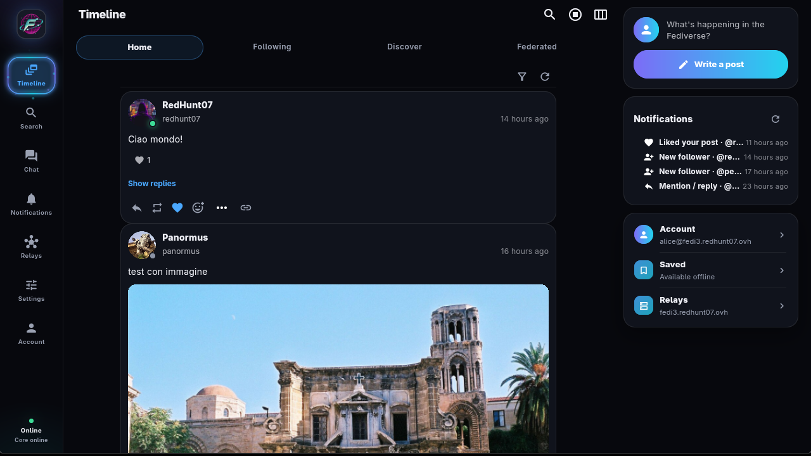
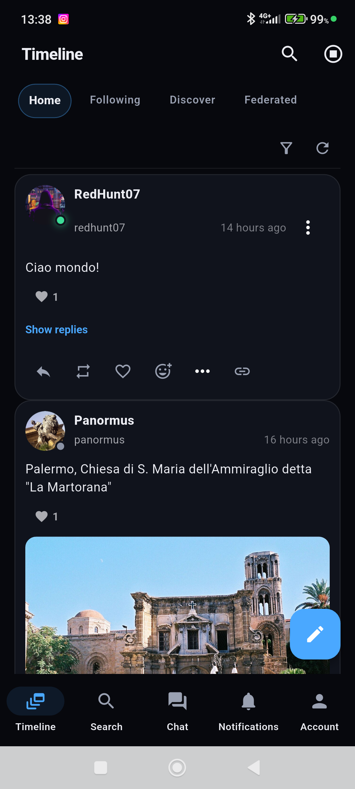
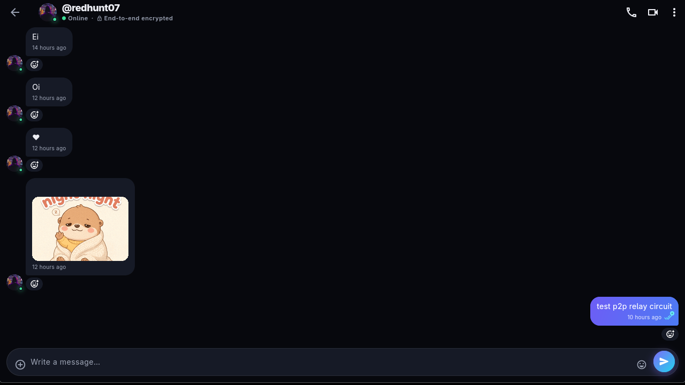
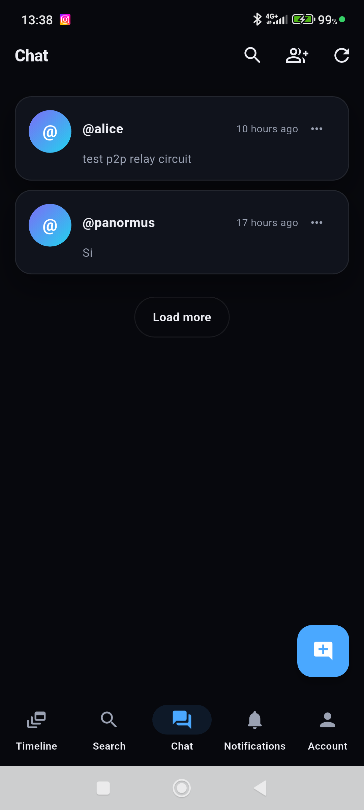

# FAQ

## What is the current version?

The current release is Fedi3 0.11.9+2012 (client build 2012). The desktop client
is distributed as a Linux AppImage and a Windows ZIP; Android and iOS builds use
the same Flutter code and the Rust core. See
[client_ux_plan.md](client_ux_plan.md#10-current-client-01192012) for the current
UI and feature status.

## What does the client look like?

The client is a desktop and mobile app with a structured, tabbed interface built
on the Aurora design system: a navigation rail with Timeline, Search, Chat,
Notifications, Relays, Settings and Account, an overlaid profile header and
tabbed timelines. The screenshots below show the current UI.

| Desktop | Android |
|---|---|
|  |  |
|  |  |

## Is the relay a complete social server?

No. The relay provides ActivityPub compatibility (actor, inbox/outbox, webfinger,
nodeinfo) and routing to users' cores through the tunnel. It does not hold
private keys and is not a Mastodon instance: it is a bridge.

## Can I use only P2P without a relay?

Yes. The core also starts without a relay: the configuration accepts an empty
`relay_ws` and the tunnel is simply disabled. In this mode you have chat and P2P
synchronization, but you are **not** reachable from traditional fediverse
instances, which only speak ActivityPub over HTTPS. For federation with
Mastodon/Misskey you need a relay (your own or public).

## Who sees my relay token?

Nobody except the relay. The client sends it as a bearer token on the tunnel; the
relay keeps only its SHA-256 hash. The token is never written to the logs.

## Where are the private keys stored?

In the core data directory, with `0600` permissions on POSIX. They are never sent
to the relay: signing happens locally. Make a separate backup of that directory
if you want to be able to migrate the account.

## Is the chat encrypted?

Yes. Chat v1 uses AES-256-GCM with per-message keys derived through HKDF-SHA256
from Kyber768 shared secrets, and RSA-SHA256 signatures. Existing chat keys and
ciphertext formats are preserved. There is no full ratcheting/forward-secrecy
guarantee. RSA-OAEP is used for compatibility HTTP envelopes and offline spool,
separately from the chat KEM.

## Does the chat show delivery and read status?

Yes. Direct chats show the interlocutor's username, chat bubbles with
delivery/read check marks and an E2E badge. You can start a chat from mutual
followers, create a group from the same screen, attach media, react, reply,
forward, pin messages, copy an invite link and delete messages. Only groups can
be renamed; direct chats keep the interlocutor's username. Groups have
owner/admin/member roles.

## Are calls end-to-end encrypted?

Calls use WebRTC with E2E chat signaling; media flows on its own connection. 1:1
and group audio/video calls are supported, with screen sharing, selectable audio
devices and ICE restart. On Android/iOS you can switch between the front and back
camera; the Linux bridge reports `NotImplemented` for that switch. A TURN relay is
still required when a direct path is impossible.

## Are there notification sounds?

Yes. The client bundles three sounds: timeline activity, chat messages and
incoming calls. On Android a keep-alive foreground service keeps notifications
running when the app is closed; push is opt-in under
**Settings → Security → Push notifications** and requires a configured relay
gateway.

## Does Android keep notifications when the app is closed?

Yes. A keep-alive foreground service keeps a headless Flutter engine alive that
polls the relay spool for timeline, chat and incoming-call activity and wakes the
local core only when there is something to deliver, with separate sounds for
activity, chat and calls. Android 14+ declares `remoteMessaging` and falls back
to `dataSync` below; Android 15 caps `dataSync` services at six hours per day.
Aggressive battery optimization can still delay delivery: allow Fedi3 to run in
the background. See the [app guide](app_guide.md).

## Where are the settings?

Settings is a hub with subpages: Account, Profile, Follow requests, Saved,
Privacy, Security, Moderation, Networking, Relays, UI, Translation, Audio, Backup,
Advanced and Updates. Announcements open from the app bar. On mobile, push
settings are under Security.

## How do I discover a relay?

The client reads the shared public directory in
[`relays/relays.json`](../relays/relays.json), probes each relay from your device
and ranks them by measured latency. See [relay_directory.md](relay_directory.md)
for the format and the contribution process. A directory entry is only an
advertisement: the client still validates the relay with a probe.

## Telemetry?

Client diagnostics are optional and stay on the device (two log files, up to
2 MiB each). There is no automatic upload to GitHub or another server. Users can
clear or export logs manually. Relay statistics and public peer discovery are
separate server features exchanged via HTTP.

## Where is media stored?

On the relay: local backend, S3 or WebDAV, configurable with
`FEDI3_RELAY_MEDIA_BACKEND`. The core keeps a local cache with space limits and
TTL.

## Why are some federated requests rejected with 401?

The relay and the core mandatorily verify the HTTP signature on every federated
POST, require a valid `Digest` and reject activities signed by an actor different
from the one declared. If a remote instance does not sign correctly, it is
rejected: this is the correct behavior, not a bug.

## Advanced P2P/ICE infrastructure?

Optional stacks are available in `deploy/p2p_infra` and `deploy/turn` (coturn for
NAT traversal). The relay can also publish a TURN pool from a private operator
file; see [network_resilience.md](network_resilience.md#community-turn-operators).

## Can I expose the relay port directly?

Better not. Put the relay behind a TLS reverse proxy and leave
`FEDI3_RELAY_BIND=0.0.0.0:8787` reachable only from the internal Docker network.
If you expose the port, enable TLS anyway and set
`FEDI3_RELAY_TRUST_PROXY_HEADERS` accordingly.

## How do I make a backup?

See [ops_backup_restore.md](ops_backup_restore.md). The scripts read the
configuration from `.env`, verify the archive and apply a retention. The app
backup exports only configuration and preferences, not the private key.

## How do I update the client?

Open **Settings → Client updates**: the app checks stable GitHub releases and
verifies the SHA256 before installing. Linux x86_64 AppImages replace themselves
keeping a backup, Windows x64 downloads a verified ZIP, and Android installs the
APK only when the signing certificate matches. Clients older than 0.10.0 need one
manual upgrade first. See [client updates](updates.md).

## Why do calls need TURN, and how is audio routed?

Calls derive coturn endpoints from the relay host when the relay publishes
`FEDI3_RELAY_TURN_*`; STUN-only calls fail when a peer sits behind a VPN or
carrier-grade NAT. Desktop **Settings → Audio** selects and tests the microphone
and output, and screen sharing sends the microphone and the PC system audio as
separate tracks. Mobile video calls can switch between the front and back camera.
See the [app guide](app_guide.md).

## Which languages are available?

The client UI is available in English and Italian; switch it in
**Settings → Appearance & language**. Documentation is bilingual: English in
`docs/`, Italian in `docs/it/`.

## How do I migrate an account to another relay?

Start the core with `previous_public_base_url` and `previous_relay_token` (or
`legacy_aliases` for older actor URLs). Migrated outbox activities are rewritten
to the current actor in the core and in the relay proxy, so classic instances see
the right author. See [local core and P2P mode](deploy_core.md).
