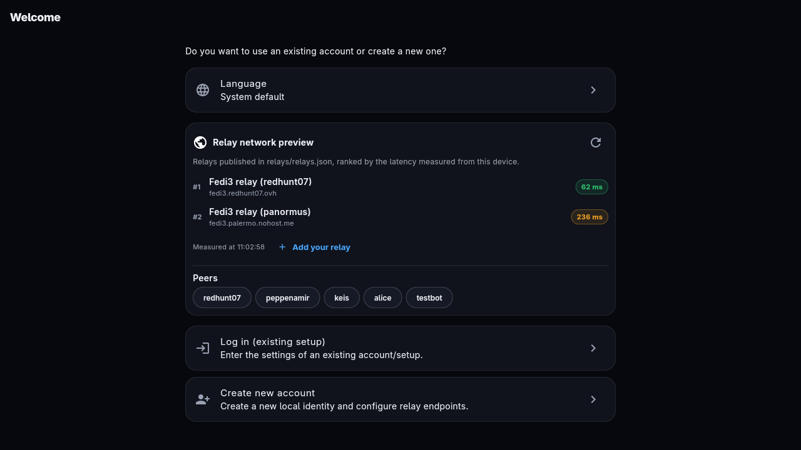

# Preparazione al rilascio — 15 novembre 2026

Versione dei sorgenti: **0.12.2+4018**. Base Git: `1abb4d2`, ramo `main`, con
modifiche locali non committate. Questo rapporto descrive un candidato locale,
non una release pubblicata né una certificazione di ogni percorso possibile.

## Correzioni effettuate

- La cache privata in chiaro del servizio Android veniva scritta anche su
  desktop e poteva aggirare il recupero del keyring. Ora lettura e scrittura
  sono limitate ad Android. Dopo l'accesso riuscito al keyring, le copie desktop
  legacy e i temporanei vengono eliminati; con keyring indisponibile restano
  conservati per recupero, senza essere caricati. Test di regressione inclusi.
- Il login rapido perdeva la porta esplicita nel passaggio HTTP→WebSocket.
  La conversione usa ora `Uri.replace`; test per HTTP/HTTPS e porte personalizzate.
- Corretti overflow nei messaggi di avvio, nelle azioni, nella selezione relay,
  nei menu di consegna e nello stato del core. Le schermate di avvio, account,
  abbinamento e impostazioni usano la larghezza comune di 720 pixel su desktop.
- I domini push configurati non raggiungevano il container Caddy. Compose ora
  li passa esplicitamente; i fallback riservati sono HTTP-only, evitando
  richieste di certificati per `*.invalid`. Verificati override e configurazione
  effettiva adattata da Caddy.
- Licenza allineata ad **AGPL-3.0-only**, su indicazione del proprietario:
  NOTICE, README, policy, metadati Rust e badge. Test del contratto di licenza.
  Il testo standard LICENSE e le licenze delle dipendenze restano quelli propri.
- Guide di aggiornamento/build corrette, documentazione di replica commentata
  in inglese, commenti italiani individuati nel core/script tradotti, istruzioni
  agenti aggiornate. Aggiunti procedura bilingue, controllo link/guide in CI e
  `scripts/verify_release.sh` per ripetere i controlli.

## Evidenze automatiche

| Controllo | Esito |
| --- | --- |
| Rust fmt, clippy workspace/all-targets con `-D warnings`, build locked | Superati |
| `cargo test --workspace --locked -- --test-threads=4` | 351 superati, 4 ignorati nella suite normale |
| Compatibilità RSA/WebRTC precedente | 2 test ignorati della suite rieseguiti separatamente e superati |
| Quota atomica PostgreSQL | Test ignorato rieseguito su PostgreSQL 16 isolato e superato |
| Flutter format e analyze con `--fatal-infos` | Superati, nessun problema |
| `flutter test --reporter expanded` | 272 superati |
| Responsive | 12 combinazioni: 3 larghezze × 2 lingue × 2 temi, testo 200%, quattro schermate |
| Contratti Compose/OpenAPI, release, relay directory, backup, AppImage ABI e documentazione | Superati |
| Repository APT firmato | Test passato in Debian 12 con dpkg/GnuPG; sul sistema host viene saltato per strumenti mancanti |
| Configurazioni piattaforme e ShellCheck | Superati |
| `cargo audit` | Nessuna vulnerabilità bloccante; 5 avvisi di manutenzione |
| `git diff --check`, `git fsck --no-reflogs` | Nessun errore; oggetti dangling presenti, non eliminati |

I test Rust comprendono federazione relay/core reali, sincronizzazione account,
replica notifiche, spool, sicurezza ActivityPub e regressioni di autenticazione.
I widget usano HTTP e runtime simulati. Il bootstrap IPFS pubblico non è stato
eseguito. I controlli non equivalgono a nuove prove reali Mastodon/Misskey o a
prove Android in Doze prolungato.

Gli avvisi RustSec riguardano `paste`, `pqcrypto-internals`, `pqcrypto-kyber`,
`pqcrypto-traits` e `rustls-pemfile`. Richiedono monitoraggio e una migrazione
compatibile per la parte crittografica, non sostituzioni arbitrarie prima del
rilascio. Android compila con avvisi relativi alla futura migrazione dei plugin
a Built-in Kotlin; la toolchain verificata resta quella fissata nel repository.

## Build e pacchetti locali

Flutter 3.50.0 / Dart 3.14.0 e Rust 1.99.1, Linux x86_64. Il CMake inizialmente
risolto dal PATH era un wrapper con interprete assente: la build è stata eseguita
con il binario CMake installato, senza cambiare i file dell'ambiente utente.

- Build core e bundle Linux release riuscite.
- `NO_BUMP=1 bash scripts/release_full_linux.sh` riuscito. AppImage avviato in
  D-Bus/Xvfb con directory XDG isolate, primo frame visibile e processo vivo;
  screenshot controllato visivamente. Questa prova locale non sostituisce le
  due prove AppImage su Ubuntu 22.04/24.04 previste dalla CI.
- `bash scripts/build_android.sh release` riuscito per arm64-v8a e x86_64.
  `apksigner verify --verbose` verifica entrambi gli APK (schema v2).
  `aapt` riporta versione 0.12.2, versionCode 6018/8018. Le 23 sezioni ELF
  allocate di ogni core incluso coincidono con quelle del core appena compilato;
  Gradle rimuove sezioni non runtime, quindi l'hash dell'intero `.so` cambia.
- Immagine Docker relay costruita, avviata in un container temporaneo:
  `/healthz` e `/readyz` restituiscono 200, metriche senza token 401.
  Database e container di prova rimossi; nessun deploy di produzione eseguito.

| Pacchetto | SHA256 |
| --- | --- |
| `dist/Fedi3-linux-x86_64.AppImage` | `ad26a4e7af457ed78c2850289844e4bfe886c79dbaf86e2a14acfc61ff064eee` |
| `app/build/app/outputs/flutter-apk/app-arm64-v8a-release.apk` | `c3df7e9652d5837ba0a87fd0ad0a2bfd757f990d92a650ba114fbd0720bb1ecb` |
| `app/build/app/outputs/flutter-apk/app-x86_64-release.apk` | `9cb0a2e99d9936e0f847e0407b9bf1f0c83186c8a09eafc9cb376cd48c79ead9` |

## Git e condizioni per il rilascio stabile

Le nove modifiche già presenti a `.env.example`, Caddyfile, Dockerfile e guide
di deploy sono state preservate. Le modifiche nuove restano nel working tree:
nessun commit, push, tag o pubblicazione. La lettura dei tag remoti mostrava
`v0.12.0` e `v0.12.1`, senza `v0.12.2` al momento del controllo.

Il candidato supera i controlli locali descritti. Prima di pubblicare:

1. Revisionare il diff complessivo e creare il commit definitivo con versione,
   note e licenza coerenti; tag e pacchetti devono identificare quel commit.
2. Ottenere la CI completa sul commit definitivo, incluse build Windows e smoke
   AppImage Ubuntu 22.04/24.04. Questa sessione non ha costruito Windows/macOS/iOS.
3. Provare i nuovi APK su dispositivo reale, aggiornamento con la firma del
   canale scelto, abbinamento, keyring/Keystore, chiamate, media e notifiche in
   background. La validità della firma APK non dimostra la compatibilità con
   ogni installazione esistente; non sono state aggiornate installazioni reali.
4. Ripetere interoperabilità e backup/ripristino sui pacchetti destinati al
   canale di rilascio. I rapporti storici non sono nuove prove di questi binari.

Procedura ripetibile: [checklist di rilascio](../release_checklist.md).
