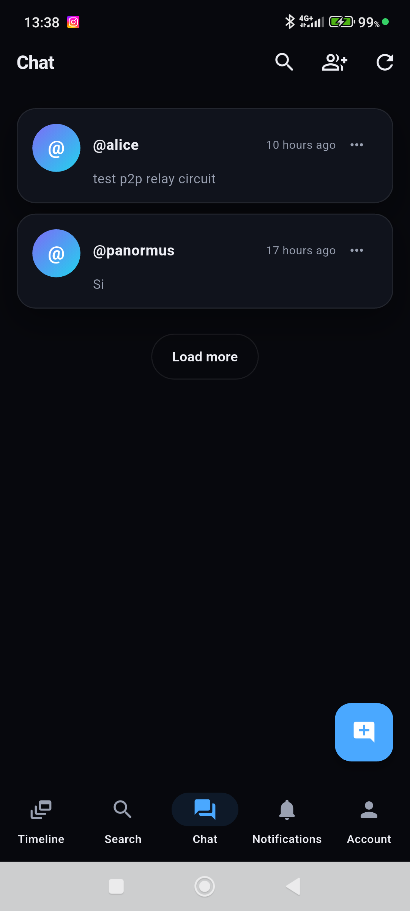
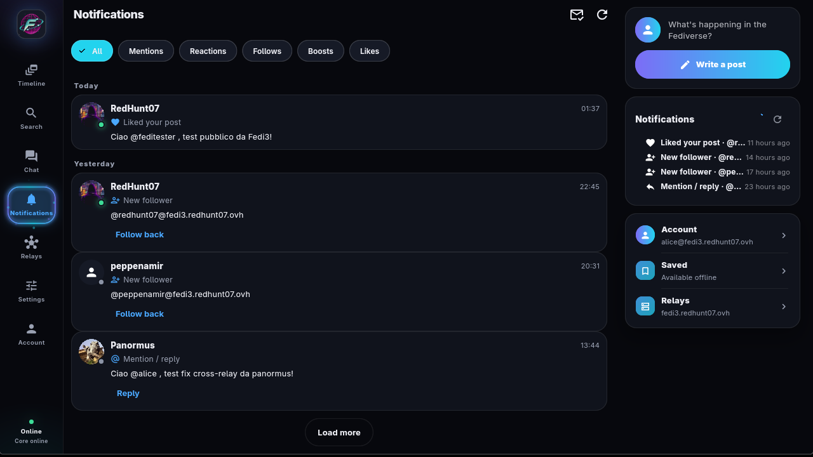
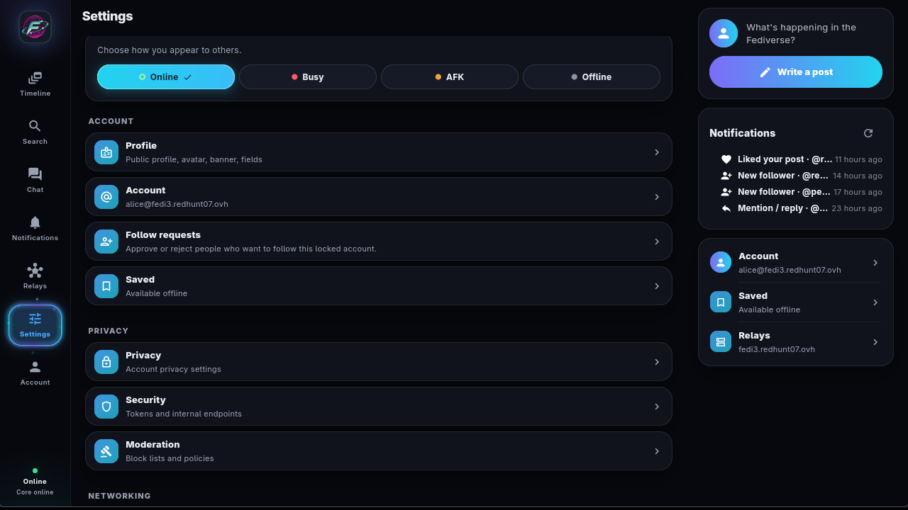
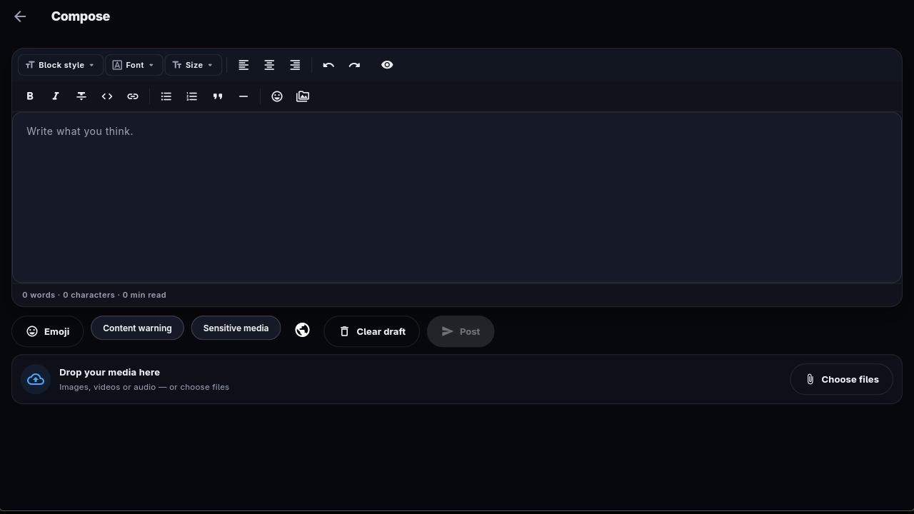
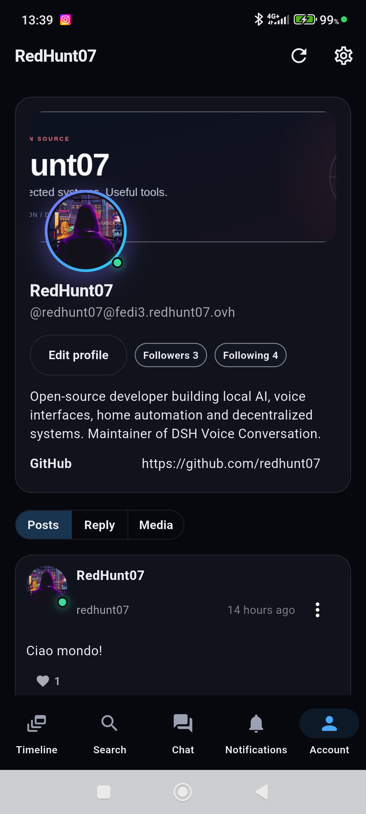
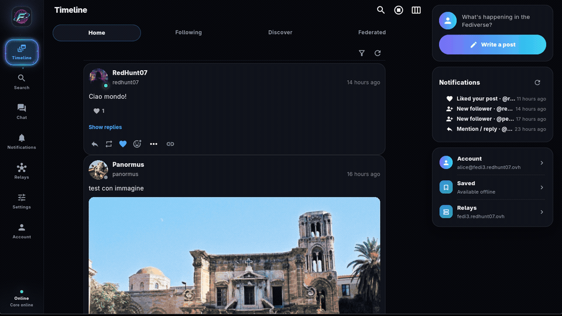

# Fedi3 — Piano di rilancio del client (UX/IA)

Data: 2026-11-01. Ultimo aggiornamento di stato: 2026-11-09, client 0.11.9+2012.
Stato: adottato; gli step 0–7 sono implementati nel client 0.11.x, lo step 8 è in
corso. Le sezioni 1–9 conservano il piano originale; le sezioni 10–12 tracciano
il client attuale e il lavoro rimanente.

## 1. Valutazione onesta

Questa sezione descrive il client all'inizio del rilancio (2026-11-01).

Difetti osservati nella verifica live:

- l'onboarding è un pannello da amministratore (bind, internal token, relay WS,
  dominio) invece di un flusso "scegli un nome e inizia";
- la timeline desktop apre quattro colonne con etichette fuorvianti: la colonna
  "Locale" mostra in realtà il feed dei follow, "Sociale" è vuota senza P2P;
- il profilo mostra attività grezze (`EmojiReact`, `Like`, `Follow`) mescolate alle
  note, senza tab Post/Risposte/Media;
- mancavano liste follower/seguiti (aggiunte ora), paginazione, empty state utili;
- impostazioni presenti ma poco discoverabili, senza ricerca interna né gerarchia
  chiara;
- nessuna identità visiva, nessun onboarding guidato, nessun percorso di recupero
  account spiegato all'utente;
- la chat è tecnicamente E2E ma povera rispetto a Misskey (allega file, react,
  thread, stato di lettura).

Il problema non è "il linguaggio sbagliato": è **architettura dell'informazione,
flussi e finitura**. Riscrivere in un altro linguaggio senza risolvere questi punti
produrrebbe lo stesso prodotto con costi maggiori.

## 2. Cosa copiare da Misskey e cosa no

Misskey è un riferimento utile per **struttura**, non per densità.

Da copiare:

- tassonomia delle impostazioni (Account, Profilo, Privacy, Sicurezza, Moderazione,
  Rete, Aspetto, Notifiche, Lingua, Backup, Informazioni) con sottopagine e ricerca;
- profilo con tab (Post, Risposte, Media, Reazioni) e contatori cliccabili;
- deck/colonne **opzionale**, non layout predefinito;
- composer sempre raggiungibile, con visibilità, allegati, emoji, sondaggi;
- ricerca unificata con filtri e cronologia;
- notifiche raggruppate e filtrabili;
- chat con allegati, reazioni, thread e stato di lettura.

Da non copiare acriticamente:

- la densità visiva e la quantità di opzioni in prima vista: Misskey è per power
  user; un nuovo utente si perde;
- la dipendenza da un server multi-utente centralizzato: Fedi3 è single-user per
  core, quindi "login/registrazione" vanno ridefiniti (vedi §4);
- il modello tutto-web: Fedi3 ha un core locale e un relay; il client desktop è
  un vantaggio, non un limite.

Posizionamento consigliato: **IA ispirata a Misskey, semplicità iniziale da
Mastodon, deck mode per chi la vuole**. Il vantaggio competitivo di Fedi3 resta
P2P/relay: il client deve sembrare normale prima di raccontarlo.

## 3. Linguaggio e piattaforma: proposta

Non riscrivere ora. Motivazioni:

- Flutter copre desktop, mobile e (con limiti) web con un solo codice; il collo di
  bottiglia è il prodotto, non il runtime;
- il core Rust e il protocollo sono l'asset: vanno stabilizzati con un'API client
  documentata, non riscritti;
- un rewrite completo costerebbe 2–3 mesi e congelerebbe le correzioni UX.

Proposta in due binari:

- **Binario A (ora)**: ridisegno di IA e flussi nel client Flutter esistente, a step
  (§6). Ogni step è rilasciabile e testabile.
- **Binario B (dopo)**: se serve la distribuzione web, un client web separato
  (React/TS o Svelte) che consuma la stessa API, condividendo design token e non
  codice. Non è un rewrite del desktop: è un secondo client.

Se in futuro si scegliesse un altro linguaggio, la condizione è avere prima
un'API stabile e documentata: senza quella, ogni client resta accoppiato agli
endpoint interni.

## 4. Autenticazione: il punto architetturale da chiarire

Oggi Fedi3 è **single-user per core**: l'identità è una chiave, non un account con
password. L'app e il core girano sulla stessa macchina e condividono un token
interno. Questo non è il modello Misskey (multi-utente, sessioni web).

Tre opzioni, in ordine di costo:

1. **Profilo locale (consigliata ora)**: "registrazione" = creazione identità
   (username + relay, opzioni avanzate nascoste); "login" = import backup oppure
   connessione a un'istanza esistente (URL + token/backup). Il client gestisce più
   profili locali con switcher. Nessuna modifica al core.
2. **Accesso remoto al core**: il core espone un'API client autenticata con bearer
   token su TLS, così un client web può collegarsi a un'istanza remota. Richiede
   CORS, token dedicati, OpenAPI e revoca.
3. **Multi-utente nel core**: il vero modello Misskey, ma è un cambio di backend
   (identità multiple, sessioni, permessi). Rinviabile.

Raccomandazione: partire da (1), progettare l'API per rendere possibile (2), non
promettere (3) finché non c'è domanda reale.

## 5. Architettura dell'informazione target

Route e schermate, in ordine di implementazione:

- `/welcome` — scelta: crea identità, importa backup, collega istanza.
- `/signup` — username, relay consigliato, avanzate collassate, recovery code
  obbligatorio e scaricabile.
- `/login` — import backup, connect URL+token, recovery code.
- `/home` — feed unico con tab Home/Locale/Federata, composer persistente,
  scroll infinito, filtri, media.
- `/explore` — ricerca unificata (post, utenti, hashtag), filtri, cronologia.
- `/notifications` — gruppi per tipo, filtri, segna come letto, real-time.
- `/messages` — lista conversazioni, thread, allegati, reazioni, stato lettura.
- `/@user` — profilo pubblico con tab Post/Risposte/Media, follow, muta, blocca,
  segnala.
- `/me` — profilo personale con tab e modifica, liste follower/seguiti paginate.
- `/settings` — hub con sottosezioni: Account, Profilo, Privacy, Sicurezza,
  Moderazione, Rete, Aspetto, Notifiche, Lingua, Backup, Informazioni, Avanzate.
- `/settings/*` — una pagina per categoria, con salvataggio esplicito e riavvio
  core dove serve.

Regole trasversali: niente token/bind in prima vista; ogni schermata ha empty
state, errore azionabile e stato di caricamento; nessuna attività grezza mostrata
all'utente se non in "Mostra raw".

## 6. Piano a step

Ogni step è un rilascio verificabile; le stime sono indicative (1 sviluppatore).

| Step | Contenuto | Dipendenze | Stima | Criterio di accettazione |
|---|---|---|---|---|
| 0 | Audit UX, design token, skeleton di navigazione e route, gate di avvio | — | 2 gg | route e stati vuoti presenti; nessuna regressione funzionale |
| 1 | Registrazione guidata, recovery code, login (backup/connect), switcher profili | API config attuale | 3 gg | nuovo utente pubblica entro 5 minuti senza toccare token |
| 2 | Home unica con tab, composer persistente, scroll infinito, media | core timeline | 4 gg | feed usabile su desktop e mobile; nessuna colonna fuorviante |
| 3 | Profilo proprio e altrui con tab, liste paginate, modifica profilo | relazioni | 4 gg | tab e liste corrette; follow/unfollow coerenti |
| 4 | Impostazioni con tassonomia completa, ricerca interna, salvataggi sicuri | schermate esistenti | 3 gg | tutte le categorie raggiungibili in ≤2 tap |
| 5 | Ricerca unificata con filtri, cronologia, lookup remoto | API search | 3 gg | risultati post/utenti/hashtag; fallback locale |
| 6 | Notifiche raggruppate, filtri, mark-read, real-time | event stream | 3 gg | gruppi e filtri corretti; badge coerente |
| 7 | Chat completa: allegati, reazioni, thread, read state | chat API | 3 gg | conversazione con media e stato lettura |
| 8 | Finitura: onboarding tour, accessibilità, temi, i18n, scorciatoie | — | 3 gg | audit accessibilità di base superato |

Totale ≈ 28 giorni; i primi tre step (0–2) danno già un client presentabile.

## 7. Lavoro backend necessario in parallelo

- **API client stabile e documentata** (OpenAPI): endpoint, errori tipizzati,
  paginazione a cursore, versioning. È il prerequisito per qualsiasi client futuro.
- **Auth per accesso remoto**: bearer token dedicato, CORS, revoca, rotazione.
- **Paginazione** per follower/seguiti e notifiche (oggi il client carica la prima
  pagina).
- **Feed profilo filtrato** lato API o client: solo Note, con tab.
- **Notifiche raggruppate** e mark-read lato server.
- **Chat**: allegati e stato di lettura se non già presenti.
- **Moderazione**: mute/block/report esposti in modo uniforme.

## 8. Rischi e metriche

Rischi: rifare l'IA senza test utente; introdurre multi-utente troppo presto;
duplicare client (desktop + web) senza API condivisa; regressioni nelle funzioni
P2P durante il restyling.

Metriche da misurare: tempo al primo post, successo dei task principali
(post, follow, risposta, ricerca), crash-free sessions, retention D1/D7,
tempo medio per trovare un'impostazione.

## 9. Proposta immediata

Partire dallo **Step 0 + Step 1** (skeleton di navigazione + registrazione/login
guidati), perché sono il cancello d'ingresso e il difetto più visibile. In
parallelo, scrivere la specifica OpenAPI minima dell'API client: senza quella,
lo Step 2 rischia di consolidare endpoint interni.

Se il vincolo è "copiare Misskey", la sequenza resta valida: si copia la
tassonomia e i flussi, non la densità, e si tiene Flutter finché l'IA non è
stabile.

## 10. Client attuale (0.11.9+2012)

Il client distribuito è un'app desktop e mobile ispirata a Misskey, costruita sul
design system Aurora: superfici neutre profonde, accenti viola/ciano, header del
profilo sovrapposto e una rail di navigazione con Timeline, Ricerca, Chat,
Notifiche, Relay, Impostazioni e Account. Non è più il pannello amministrativo
descritto nella §1.

| Desktop | Android |
|---|---|
|  |  |
|  |  |

Comportamento attuale per area:

| Area | Comportamento |
|---|---|
| Timeline | Tab Home, Seguiti, Scopri e Federata; filtri; scroll infinito; media federati; composer con visibilità, allegati e toolbar MFM. |
| Profili | Banner dietro l'avatar, contatori cliccabili, tab Post/Risposte/Media, outbox paginato e liste follower/seguiti con follow/unfollow. |
| Chat | Bolle stile Telegram con spunte di consegna/lettura, badge E2E, selettore destinatari dai follower reciproci, creazione gruppi dalla stessa schermata, ruoli owner/admin/member, rinomina solo per i gruppi, eliminazione messaggi, allegati, reazioni, risposte, inoltro, messaggi fissati, link invito, digitazione e presenza. |
| Chiamate | Chiamate audio/video E2E 1:1 e di gruppo su WebRTC, TURN automatico dal relay, condivisione schermo con microfono e audio di sistema PC come tracce separate, dispositivi audio selezionabili, ICE restart e azione Retry manuale. Android/iOS commutano tra fotocamera anteriore e posteriore; il bridge Linux riporta `NotImplemented` per quel cambio. |
| Notifiche | Notifiche raggruppate e filtrabili, mark-as-read, aggiornamenti in tempo reale e tre suoni inclusi: attività della timeline, chat e chiamata in arrivo (toni in stile Discord). Android usa un servizio foreground keep-alive con tipi compatibili con Android 15. |
| Impostazioni | Hub con Account, Profilo, Privacy, Sicurezza, Moderazione, Rete, Relay, UI, Traduzione, Audio, Backup, Avanzate e Aggiornamenti; il push è sotto Sicurezza su mobile. Gli annunci si aprono dalla barra dell'app. |
| Ricerca | Post, utenti e hashtag; filtro fonte tutti/locale/relay; cronologia persistente con chip e cancellazione; ricerca globale nella chat. |
| Mobile | Build Android e iOS, provisioning UnifiedPush/APNs, suoni di notifica, navigazione a task unico, cambio fotocamera nelle videochiamate. |
| Aggiornamenti | Aggiornamenti verificati del client (SHA256) per AppImage Linux, ZIP Windows e APK Android. |
| Accessibilità | Scorciatoie da tastiera (Ctrl+1…7, Ctrl+N, Ctrl+F, Esc), etichette accessibili della rail e stati vuoti/errore. |
| Localizzazione | Interfaccia bilingue inglese/italiano con parità ARB. |

Altre schermate:

| | |
|---|---|
|  |  |
|  |  |

## 11. Stato di avanzamento (2026-11-09)

| Step | Stato | Note |
|---|---|---|
| 0 — Audit, design token, skeleton, gate di avvio | completato | tema Aurora, rail custom, route, empty state; manca un router dichiarativo. |
| 1 — Registrazione/login guidati, recovery | completato | identità/relay in primo piano, login rapido da URL+token, avanzate collassate e dialog del codice di recovery. |
| 2 — Home unica con tab | completato | Home/Seguiti/Scopri/Federata, composer full-screen dalla rail e FAB mobile. |
| 3 — Profilo proprio/altrui | completato (base) | banner sovrapposto, contatori, tab Post/Risposte/Media, griglia media, paginazione outbox; mancano filtri media avanzati. |
| 4 — Impostazioni | completato (visual) | hub raggruppato con icone e sottopagine; manca la ricerca interna nelle impostazioni. |
| 5 — Ricerca | completato (base) | post/utenti/hashtag, filtro fonte, cronologia persistente; mancano filtri temporali. |
| 6 — Notifiche | completato | filtri, mark-all-read, raggruppamento per attore/tipo e data, badge in tempo reale. |
| 7 — Chat | completato | thread, allegati con anteprima, reazioni, read state, badge E2E, chiamate E2E, note audio/video, ricerca, inoltro, messaggi fissati, link invito, bolle stile Telegram, ruoli di gruppo ed eliminazione. |
| 8 — Finitura | parziale | scorciatoie, rail accessibile, particelle, annunci, notifiche compatte, post salvati offline, composer con drag&drop e presenza; restano audit completo del contrasto e navigazione da tastiera completa. |

Nel ciclo 0.11.x sono stati consegnati anche: logo neon e icone di avvio, effetti
particellari continui nella rail, coerenza della federazione per follow in attesa
e pagine profilo, normalizzazione dell'outbox migrato e indirizzi P2P relayed.

## 12. Prossimi passi

- Pubblicare il client web sulla specifica OpenAPI e mantenerlo un secondo client,
  non una riscrittura del desktop.
- Eseguire un audit completo di contrasto/accessibilità e completare la navigazione
  da tastiera.
- Aggiungere ricerca interna nelle impostazioni, filtri media avanzati e filtri
  temporali nella ricerca.
- Verificare i bridge TURN esterni e le chiamate 1:1/di gruppo su reti e dispositivi
  reali.
- Mantenere misurabile il lavoro su batteria e notifiche in background Android
  (CPU, GPU, RAM) senza indebolire il modello di sicurezza P2P/relay.

