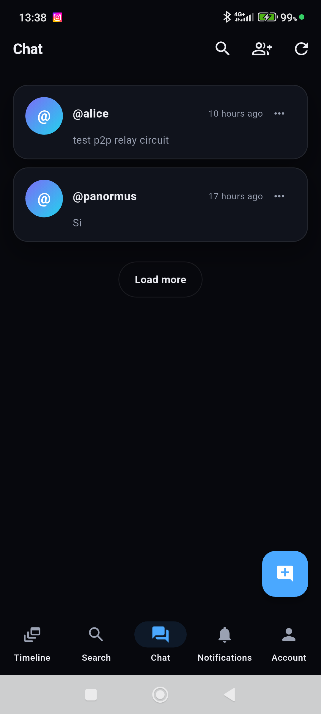

# FAQ

## Qual è la versione attuale?

La release attuale è Fedi3 0.11.9+2012 (build client 2012). Il client desktop è
distribuito come AppImage Linux e ZIP Windows; le build Android e iOS usano lo
stesso codice Flutter e il core Rust. Vedere
[client_ux_plan.md](client_ux_plan.md#10-client-attuale-01192012) per l'interfaccia
e lo stato delle funzioni.

## Che aspetto ha il client?

Il client è un'app desktop e mobile con un'interfaccia strutturata a schede,
costruita sul design system Aurora: una rail di navigazione con Timeline,
Ricerca, Chat, Notifiche, Relay, Impostazioni e Account, un header del profilo
sovrapposto e timeline a schede. Gli screenshot qui sotto mostrano l'interfaccia
attuale.

| Desktop | Android |
|---|---|
|  |  |
|  |  |

## Il relay è un server social completo?

No. Il relay fornisce compatibilità ActivityPub (actor, inbox/outbox, webfinger,
nodeinfo) e routing verso i core degli utenti tramite tunnel. Non tiene le chiavi
private e non è un'istanza Mastodon: è un ponte.

## Posso usare solo P2P senza relay?

Sì. Il core si avvia anche senza relay: la configurazione accetta un `relay_ws`
vuoto e il tunnel viene semplicemente disattivato. In questa modalità hai chat e
sincronizzazione P2P, ma **non** sei raggiungibile dalle istanze del fediverso
tradizionale, che parlano solo ActivityPub su HTTPS. Per la federazione con
Mastodon/Misskey serve un relay (tuo o pubblico).

## Chi vede il mio token del relay?

Nessuno tranne il relay. Il client lo invia come bearer token sul tunnel; il relay
ne conserva solo l'hash SHA-256. Il token non viene mai scritto nei log.

## Dove sono salvate le chiavi private?

Nella directory dati del core, con permessi `0600` su POSIX. Non vengono mai
inviate al relay: la firma avviene in locale. Fai un backup separato di quella
directory se vuoi poter migrare l'account.

## La chat è cifrata?

Sì. Chat v1 usa AES-256-GCM con chiavi per messaggio derivate tramite HKDF-SHA256
da segreti condivisi Kyber768, e firme RSA-SHA256. Le chiavi e i formati del
ciphertext esistenti sono preservati. Non c'è una garanzia completa di
ratcheting/forward secrecy. RSA-OAEP è usato per gli envelope HTTP di
compatibilità e per lo spool offline, separatamente dal KEM della chat.

## La chat mostra lo stato di consegna e lettura?

Sì. Le chat dirette mostrano il nome dell'interlocutore, bolle con spunte di
consegna/lettura e badge E2E. Puoi avviare una chat dai follower reciproci,
creare un gruppo dalla stessa schermata, allegare media, reagire, rispondere,
inoltrare, fissare messaggi, copiare un link invito ed eliminare messaggi. Solo i
gruppi possono essere rinominati; le chat dirette mantengono il nome
dell'interlocutore. I gruppi hanno ruoli owner/admin/member.

## Le chiamate sono cifrate end-to-end?

Le chiamate usano WebRTC con signaling E2E nella chat; i media viaggiano su una
connessione propria. Sono supportate chiamate audio/video 1:1 e di gruppo, con
condivisione schermo, dispositivi audio selezionabili e ICE restart. Su
Android/iOS puoi passare dalla fotocamera anteriore a quella posteriore; il bridge
Linux riporta `NotImplemented` per quel cambio. Serve comunque un relay TURN
quando un percorso diretto è impossibile.

## Ci sono suoni di notifica?

Sì. Il client include tre suoni: attività della timeline, messaggi di chat e
chiamate in arrivo. Su Android un servizio foreground keep-alive mantiene le
notifiche quando l'app è chiusa; il push è opt-in in
**Impostazioni → Sicurezza → Notifiche push** e richiede un gateway configurato
sul relay.

## Android mantiene le notifiche quando l'app è chiusa?

Sì. Un servizio foreground keep-alive mantiene vivo un engine Flutter headless per
le notifiche di timeline, chat e chiamate in arrivo, con suoni distinti per
attività, chat e chiamate. Da Android 14 dichiara `remoteMessaging` e sotto usa
`dataSync`; Android 15 limita i servizi `dataSync` a sei ore al giorno. Un'ottimizzazione
batteria aggressiva può ritardare la consegna: consenti a Fedi3 di restare attiva
in background. Vedi la [guida dell'app](app_guide.md).

## Dove sono le impostazioni?

Le impostazioni sono un hub con sottopagine: Account, Profilo, Richieste di
follow, Salvati, Privacy, Sicurezza, Moderazione, Rete, Relay, UI, Traduzione,
Audio, Backup, Avanzate e Aggiornamenti. Gli annunci si aprono dalla barra
dell'app. Su mobile, le impostazioni push sono sotto Sicurezza.

## Come scopro un relay?

Il client legge la directory pubblica condivisa in
[`relays/relays.json`](../../relays/relays.json), misura ogni relay dal tuo
dispositivo e li ordina per latenza misurata. Vedere
[relay_directory.md](relay_directory.md) per il formato e il processo di
contribuzione. Una voce della directory è solo un annuncio: il client valida
comunque il relay con una misura.

## Telemetria?

La diagnostica del client è opzionale e resta sul dispositivo (due file di log,
fino a 2 MiB ciascuno). Non c'è upload automatico su GitHub o su un altro server.
Gli utenti possono cancellare o esportare i log manualmente. Le statistiche del
relay e la discovery pubblica dei peer sono funzioni server separate, scambiate
via HTTP.

## Dove sono salvati i media?

Sul relay: backend locale, S3 o WebDAV, configurabile con
`FEDI3_RELAY_MEDIA_BACKEND`. Il core mantiene una cache locale con limiti di
spazio e TTL.

## Perché alcune richieste federate vengono rifiutate con 401?

Il relay e il core verificano obbligatoriamente la firma HTTP su ogni POST
federato, richiedono un `Digest` valido e rifiutano le attività firmate da un
attore diverso da quello dichiarato. Se un'istanza remota non firma correttamente,
viene rifiutata: è il comportamento corretto, non un bug.

## Infrastruttura P2P/ICE avanzata?

Stack opzionali sono disponibili in `deploy/p2p_infra` e `deploy/turn` (coturn per
il NAT traversal). Il relay può anche pubblicare un pool TURN da un file privato
di operatori; vedere [network_resilience.md](network_resilience.md#operatori-turn-della-comunità).

## Posso esporre direttamente la porta del relay?

Meglio di no. Metti il relay dietro un reverse proxy TLS e lascia
`FEDI3_RELAY_BIND=0.0.0.0:8787` raggiungibile solo dalla rete interna di Docker.
Se esponi la porta, abilita comunque TLS e imposta
`FEDI3_RELAY_TRUST_PROXY_HEADERS` di conseguenza.

## Come faccio un backup?

Vedi [ops_backup_restore.md](ops_backup_restore.md). Gli script leggono la
configurazione da `.env`, verificano l'archivio e applicano una retention. Il
backup dell'app esporta solo configurazione e preferenze, non la chiave privata.

## Come aggiorno il client?

Apri **Impostazioni → Aggiornamenti del client**: l'app controlla le release
stabili su GitHub e verifica lo SHA256 prima di installare. Gli AppImage Linux
x86_64 si sostituiscono conservando un backup, Windows x64 scarica uno ZIP
verificato e Android installa l'APK solo quando il certificato di firma coincide.
I client precedenti alla 0.10.0 richiedono un primo aggiornamento manuale. Vedi
[aggiornamenti del client](updates.md).

## Perché le chiamate richiedono TURN e come viene instradato l'audio?

Le chiamate derivano gli endpoint coturn dall'host del relay quando il relay
pubblica `FEDI3_RELAY_TURN_*`; le chiamate solo STUN falliscono se un peer è
dietro VPN o NAT carrier-grade. Su desktop **Impostazioni → Audio** seleziona e
prova microfono e uscita, e la condivisione schermo invia microfono e audio di
sistema del PC come tracce separate. Le videochiamate mobile possono passare dalla
fotocamera anteriore a quella posteriore. Vedi la [guida dell'app](app_guide.md).

## Quali lingue sono disponibili?

L'interfaccia del client è disponibile in inglese e italiano; la cambi in
**Impostazioni → Aspetto e lingua**. La documentazione è bilingue: inglese in
`docs/`, italiano in `docs/it/`.

## Come migro un account su un altro relay?

Avvia il core con `previous_public_base_url` e `previous_relay_token` (oppure
`legacy_aliases` per i vecchi URL dell'actor). Le attività migrate dell'outbox
vengono riscritte sull'actor corrente nel core e nel proxy del relay, così le
istanze classiche vedono l'autore corretto. Vedi
[core locale e modalità P2P](deploy_core.md).
